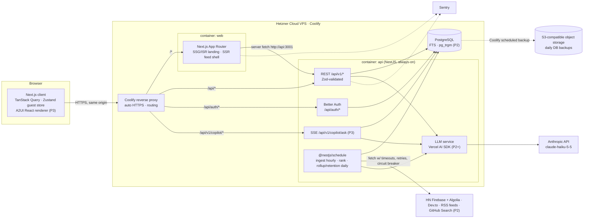
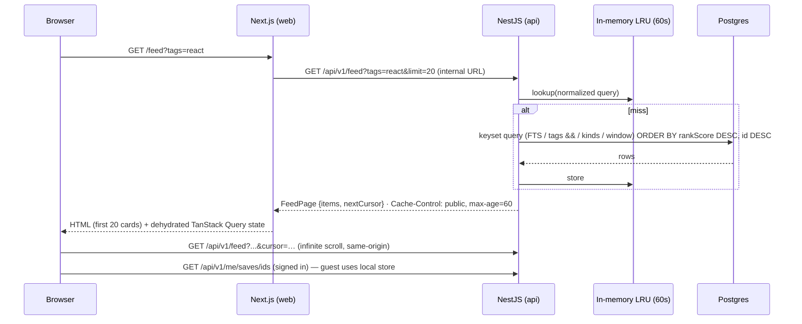
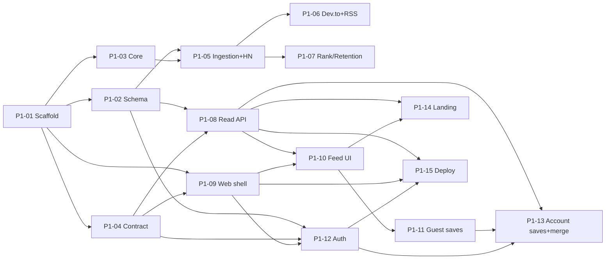

# DevBrief — Product Requirements Document

| | |
|---|---|
| **Status** | v1.0 — approved for Phase 1 implementation |
| **Date** | 2026-11-19 |
| **Product** | DevBrief (`devbrief.dev`, a placeholder: the domain is not purchased yet) |
| **Repo** | `soheilaghayour/dev-brief` (pnpm monorepo) |
| **Readers** | Product owner, orchestrator, AI coding agents (one GitHub issue each), reviewers |
| **Related docs** | `docs/architecture.md` (incl. AI architecture), `docs/development.md`, `docs/operations.md`, `docs/changelog.md` |

**How to use this document.** Every requirement has a stable ID: `F1.3` is a feature, `AC-1.3.4` is an acceptance criterion and `P1-08` is a work item. GitHub issues must cite the IDs they implement. If an issue conflicts with this PRD, the PRD wins until it is amended by PR.

**Glossary**

| Term | Meaning |
|---|---|
| **Source** | One upstream feed: Hacker News, Dev.to, one RSS blog, or GitHub (Phase 2). |
| **SourceItem** | One appearance of a link on one source, such as HN item 4231 or Dev.to article 9981. It carries that source's engagement numbers. |
| **Story** | One canonical link after exact dedup. It has 1..n SourceItems. It is the unit shown on a feed card in Phase 1. |
| **Cluster** | Phase 2. A group of distinct Stories about the same event, such as a release post, its HN thread and a Dev.to write-up. |
| **Briefing** | Phase 3. A generated, interactive answer to a research question, rendered as an A2UI surface. |
| **Guest** | A visitor without an account. Their state lives in `localStorage`. They can do everything except sync. |

---

## 1. Executive Summary & Differentiation

### 1.1 One-liner
**DevBrief is a fast, keyboard-first developer news reader.** Every hour it pulls Hacker News, Dev.to and curated engineering blogs. It merges duplicates, tags stories by technology and ranks them fairly across sources. Later phases add AI summaries of what the comments actually debate, and generative-UI research briefings. No login is needed to use it.

### 1.2 Problem
| Pain | Today |
|---|---|
| **Duplicate noise** | The same release shows up on HN, Dev.to, Reddit and three newsletters. Each copy is a separate item to triage. |
| **Unfair or opaque ranking** | Daily.dev's feed is SEO-heavy and dominated by engagement farming. HN's front page favours HN-native content. Blogs have no engagement signal at all. |
| **Signal is buried in comments** | The real technical trade-offs sit in 300-comment threads that nobody has time to read. |
| **Passive consumption** | Newsletters like TLDR are static. You cannot ask "what did people argue about in TypeScript tooling this week?" |
| **Dead bookmarks** | Saved links pile up with no context and no organisation. |

### 1.3 Differentiation
| | Daily.dev | TLDR (newsletter) | HN front page | **DevBrief** |
|---|---|---|---|---|
| Cross-source dedup | Weak (one card per source post) | Manual, curated | n/a | Exact URL and title dedup (P1); AI-assisted clustering behind a deterministic pre-filter (P2) |
| Fair cross-source ranking | Engagement plus personalisation, opaque | Editorial | HN votes only | Per-source percentile × age decay, a documented formula (Appendix B) |
| Comment synthesis | No | No | No | 3-bullet TL;DR and "Community Consensus" pros/cons (P2) |
| Ask a question, get a structured answer | No | No | No | ⌘K "Ask the News", which streams a native-component briefing (P3, A2UI v1.0) |
| Trends | No | No | No | Tech Radar: 7/30-day tag velocity (P3) |
| Usable without an account | Partially | Email required | Yes | Yes, fully. Saves and collections stay local, and you sign in only to sync |
| Keyboard-first | Partial | n/a | No | j/k, s, /, ?, ⌘K throughout |

### 1.4 What the project demonstrates
| Capability | Evidence in DevBrief |
|---|---|
| Senior frontend craft | App Router SSG/ISR landing with Lighthouse ≥ 95, dense accessible feed, optimistic UI, URL-as-state, keyboard navigation, dark/light themes, generative UI rendered with native React components |
| Product ownership | Phased scope, a guest-first funnel, a cost model, measurable acceptance criteria, a public changelog |
| Pragmatic full stack | NestJS REST with a Zod contract shared with the web app, a relational Prisma schema, Postgres full-text search and `pg_trgm`, scheduled ingestion with circuit breaking, OAuth sessions |
| AI engineering with guardrails | Structured outputs, an under-$2/month spend cap, caching, prompt-injection boundaries, an LLM classifier behind a cheap deterministic pre-filter, no embeddings (deliberate) |
| Operability | One VPS run by Coolify, CI on every PR, Sentry, backups, a health endpoint, no Kubernetes or queues |

### 1.5 Product principles
1. **No login wall, ever.** Every read and personal-state feature works for guests. Accounts exist only for sync.
2. **Fast before clever.** Static landing, a server-rendered first feed page, no images on cards, code-split heavy features.
3. **Deterministic first, LLM second.** Tagging, ranking and dedup are pure, tested functions. Clustering finds its candidates the same way. The LLM writes prose and briefing composition, and it makes one bounded same-story decision for each new story that has clustering candidates, always inside a schema and a budget. A failed call leaves the story unclustered.
4. **One process per concern, not per feature.** A single API process (REST, SSE and cron). No queues, no workers, no microservices.
5. **Show only what has shipped.** The landing page and navigation hide features behind phase flags, so there are no "coming soon" teasers.

### 1.6 Success metrics
| Metric | Target | Phase |
|---|---|---|
| Landing Lighthouse (mobile): Performance / A11y / Best Practices / SEO | ≥ 95 / ≥ 95 / ≥ 95 / ≥ 95 | P1 |
| Time from landing load to an interactive feed via the CTA | ≤ 1.5 s on desktop broadband | P1 |
| Hourly ingestion runs with ≥ 1 healthy source | ≥ 99% over 7 days | P1 |
| Ingestion source-run success rate (per source) | ≥ 95% over 7 days | P1 |
| Feed API p95 server time | ≤ 150 ms | P1 |
| Exact-duplicate cards visible in Top (last 24 h) | 0 | P1 |
| Cluster precision / recall on the labelled fixture (recorded model replies) | ≥ 0.90 / ≥ 0.70 | P2 |
| LLM spend | < $2.00 per calendar month, enforced by a hard cap | P2–P3 |
| Copilot time to first rendered component | ≤ 3 s at p50 | P3 |

### 1.7 Non-goals (all phases)
Email sending or newsletters, push notifications, native mobile apps, user-submitted links, public profiles, comments or social features, an admin UI (sources are managed by a seed file), multi-language UI (English only), embeddings or vector search, Kubernetes, queues and microservices.

---

## 2. Landing Page & First-Impression Blueprint

**Design references:** [Linear](https://linear.app) for crisp type, an interactive product frame in the hero, subtle 1 px borders, gradient hairlines and restrained motion. [Raycast](https://www.raycast.com) for keycap visuals, a keyboard-first story and a dark-mode-first aesthetic.

**Rendering:** `app/(marketing)/page.tsx` is statically generated with ISR (`export const revalidate = 900`). Live preview data is fetched at build or revalidate time from `API_INTERNAL_URL`. If the API is unreachable on the very first build, the page renders from a committed fixture snapshot, `apps/web/src/content/landing-fixture.json`, and shows a small "Sample data" label. After that, ISR keeps serving the last good page.

### 2.1 Section-by-section layout

| # | Section | Layout and content | Interactivity | Phase |
|---|---|---|---|---|
| 0 | **Top nav** | Sticky, translucent background with backdrop blur and a 1 px bottom border. Left: logo and wordmark. Center: Feed, Radar (P3) and GitHub (repo link). Right: theme toggle, "Sign in" (ghost) and "Explore feed" (primary, small). | The nav collapses to a sheet below 768 px. | P1 |
| 1 | **Hero** | An eyebrow pill with live counts, e.g. "Updated 14 min ago · 312 stories today · 12 sources". Then the H1, a one-sentence subhead and two CTAs: primary **"Explore the feed — no login required"** → `/feed`, and secondary "Sign in with GitHub". Below them sits the **live preview window** (§2.3). | See §2.3 | P1 |
| 2 | **Source strip** | One line of monospace wordmarks (text only, no third-party logos): `Hacker News · Dev.to · React Blog · TypeScript Blog · Vercel · Cloudflare · Netflix Tech · Uber Eng · Simon Willison · Josh Comeau …`. GitHub is added in P2. | None | P1 |
| 3 | **Problem** | Three bordered cards: "Same story, five tabs", "Rankings you can't trust", "Signal buried in comments". Each has a 1-line pain statement and a tiny illustrative mock. | Hover lifts the border colour. | P1 |
| 4 | **How it works** | Three steps joined by a hairline connector: **Ingest hourly** → **Dedupe and tag** → **Rank fairly**. Each step has a 2-line explanation and a "See the formula" link to Appendix B of this PRD on GitHub. | None | P1 |
| 5 | **Feature bento** | A bento grid: 3 tiles in P1, up to 8 by P3. Tiles appear only when their feature flag is on. P1: "Keyboard-first feed", "Guest mode, real features", "Fair cross-source ranking". P2 adds "One card per story" and "TL;DR + Community Consensus". P3 adds "Ask the News", "Tech Radar" and "Collections & notes". | Each tile has a short looped CSS/SVG animation that respects `prefers-reduced-motion`. | P1+ |
| 6 | **Keyboard showcase** | Raycast-style row of keycaps: `J` `K` `S` `/` `?`. P3 adds `⌘K`. Each keycap has a one-word label. | Pressing a shown key on the landing page animates its keycap. This works only while the section is in view and focus is not in an input. | P1 |
| 7 | **Example briefings** | Three tabs, each a question such as "What were this week's TypeScript tooling debates?". The tab body renders a **pre-generated** A2UI briefing through the real renderer. | Tabs; the renderer is lazy-loaded on scroll into view, at zero runtime LLM cost. | P3 |
| 8 | **Under the hood** | Aimed at engineers and recruiters. A mini architecture diagram, stack badges (Next.js, NestJS, Prisma, PostgreSQL, TanStack Query, Vercel AI SDK, A2UI), and links to the GitHub repo, this PRD, the OpenAPI docs (`/api/v1/docs`) and the changelog. Includes the line "Built end-to-end by one engineer." | Links | P1 |
| 9 | **FAQ** | 5–6 accordion items: "Do I need an account?", "How are stories ranked?", "What data do you store?", "Does it cost anything?", "How do the AI features stay cheap?" (P2+), "Is it open source?" | Accordion (Radix) | P1 |
| 10 | **Final CTA band** | The H2 "Your morning scan, in five minutes." plus the primary CTA. | None | P1 |
| 11 | **Footer** | GitHub, API docs, Changelog, Source status, **Impressum**, **Privacy (Datenschutz)** and © year. | None | P1 |

### 2.2 Copy direction
Copy should be confident, concrete and technical. Lead with verbs and avoid superlatives. Use numbers wherever they are real: live counts and source counts.

| Slot | Phase 1 sample | Phase 2/3 variant |
|---|---|---|
| H1 (pick one) | "Developer news, minus the noise." · "Every source. One feed. Ranked fairly." · "The five-minute scan for busy engineers." | P2: "Same story on HN and Dev.to? You'll see it once." · P3: "Ask the news. Get a briefing, not a wall of text." |
| Subhead | "DevBrief pulls Hacker News, Dev.to and the best engineering blogs every hour, merges duplicates, tags by technology and ranks everything on one fair scale. No account needed." | P2 adds: "…with the pros and cons from every comment section." |
| Primary CTA | "Explore the feed — no login required" | Unchanged |
| Secondary CTA | "Sign in with GitHub" | Unchanged |
| Guest hint (in-app) | "You're browsing as a guest. Saves stay on this device. Sign in to sync anywhere." | P3 adds: "…including collections and notes." |
| Problem card 1 | "Same story, five tabs. A release lands on HN, Dev.to and three blogs. You read about it five times." | |
| Problem card 2 | "Rankings you can't trust. 300 HN points and 40 Dev.to reactions aren't comparable. We normalise them." | |
| Problem card 3 | "Signal buried in comments. The real trade-offs live in thread #212." | P2: "We pull them out for you." |
| Under the hood | "Next.js + NestJS + PostgreSQL on a single €5 VPS. Typed end to end. Read the PRD." | |
| Final CTA | "Your morning scan, in five minutes." | |

### 2.3 Interactive hero preview
A product "window" framed like Linear's: rounded border, three window dots and a fake title bar reading `devbrief.dev/feed`. Inside is a slimmed-down version of the real feed.

| Element | Behaviour |
|---|---|
| Data | The top 30 stories from the last 24 h (`GET /api/v1/feed?sort=top&limit=30`) are embedded in the static HTML at build/ISR. The **first 6 render server-side**, so no spinner and no CLS. |
| Tag chips | A row of 6 chips: All, React, TypeScript, AI/LLMs, System Design, Databases. Clicking filters the embedded 30 stories **client-side** with an instant list animation. |
| Keyboard | When the preview is focused (click or Tab), `j`/`k` move the active card, `s` toggles a "Saved" demo state stored in the real guest store (so it carries over to `/feed`), and `Enter` opens `/feed?focus=<storyId>`. A muted hint line shows `J K to navigate · S to save · Enter to open`. |
| Story card | The real `<StoryCard>` component in compact density: source badges with points and comments, domain, relative time and up to 3 tags. |
| Footer of window | "Showing 6 of 312 stories today → Open full feed". |
| Hydration budget | The preview is the only client island above the fold. It must be ≤ 25 KB gzip on top of the framework baseline. |
| Phase 3 | The window gains a segmented control, **Feed \| Briefing**. "Briefing" lazy-loads the A2UI renderer and shows example briefing #1. |

### 2.4 Guest "Explore Feed — no login required" flow
```
Landing (/) ──click "Explore the feed"──▶ /feed            (SSR first page, < 1 s)
   │                                         │
   │                                         ├─ dismissible GuestHintBar (shown once; dismissal stored locally)
   │                                         ├─ "?" opens shortcuts dialog; "/" focuses search
   │                                         ├─ filter by tags/sources → URL updates (shareable)
   │                                         └─ "s" saves → toast "Saved on this device · Sign in to sync"
   │                                                     │
   └─────────────── any "Sign in" ───────────────────────┴─▶ /sign-in?callbackURL=<current URL>
                                                              │ GitHub or Google OAuth
                                                              ▼
                                         back on the same URL → POST /api/v1/me/merge (local state)
                                         → toast "3 saved stories synced to your account"
                                         → local store cleared of merged items; server is source of truth
```
Rules:
- No modal, interstitial, cookie banner or email capture anywhere in this flow. Only essential cookies are used: the session cookie after sign-in, plus theme stored in `localStorage`.
- Every sign-in entry point preserves the current URL through `callbackURL`.
- Deep links work for guests, for example `/feed?tags=react,typescript&sort=latest` and `/story/<id>`.

### 2.5 Landing acceptance criteria
- **AC-L1** Given the API is healthy, when `/` is requested, then the initial HTML contains ≥ 6 rendered story titles from the last 24 h, and no client fetch is needed for them.
- **AC-L2** Given the API is unreachable on the first build, when the site builds, then the build succeeds using `landing-fixture.json`, and the preview shows the "Sample data" label.
- **AC-L3** Given CI runs Lighthouse (mobile preset) against the production build of `/`, then Performance, Accessibility, Best Practices and SEO are each ≥ 95. The PR fails otherwise.
- **AC-L4** Given a guest clicks the primary CTA, then `/feed` (Top, default params omitted from the URL) loads with no authentication prompt.
- **AC-L5** Given the preview has focus, when the user presses `j` three times and then `Enter`, then the browser navigates to `/feed?focus=<id of 4th card>`.
- **AC-L6** Given the OS is in dark mode and no theme is stored, then the page renders dark on first paint with no light flash. The theme toggle choice persists across reloads.
- **AC-L7** Given a feature flag for a later phase is off, then its bento tile, nav item and copy variant are absent from the HTML.
- **AC-L8** `/impressum` and `/privacy` exist, are linked from the footer, and are statically rendered.
- **AC-L9** The page has a `<title>`, a meta description, a canonical URL, Open Graph and Twitter tags, and a generated OG image (`opengraph-image.tsx`).
- **AC-L10** With `prefers-reduced-motion: reduce`, no looping animations run.

---

## 3. Phased Feature Breakdown

| Phase | Theme | Target | GitHub issues |
|---|---|---|---|
| **1 — MVP** | Landing, clean feed, guest mode, auth and sync | 1–2 weeks, built by agents with one issue each | Created right after this PRD (Appendix C) |
| **2 — V2** | Clustering, AI TL;DR and consensus, GitHub source, follow/mute | After Phase 1 is live | Created when Phase 2 starts |
| **3 — V3** | A2UI research copilot, Tech Radar, collections and notes | After Phase 2 | Created when Phase 3 starts |

Phase flags live in `apps/web/src/config/features.ts` (`clusters`, `summaries`, `preferences`, `copilot`, `radar`, `collections`), and their API equivalents live in env (`FEATURE_*`). A flag that is off hides the UI entry points. The matching API routes then return 404.

### 3.1 Phase 1 — MVP

**Goal:** a fast, polished, live app that a recruiter can explore within 10 seconds of opening the URL. It is backed by a typed NestJS + PostgreSQL API with hourly ingestion. There is no AI in this phase.

**In scope**
| ID | Feature |
|---|---|
| F1.1 | Public landing page with a live hero preview (§2) |
| F1.2 | Hourly ingestion from HN, Dev.to and ~10 curated RSS feeds, with exact dedup and deterministic tagging |
| F1.3 | Feed: Top/Latest, multi-tag filter, source-kind filter, full-text search, infinite scroll, keyboard navigation and a story page |
| F1.4 | Guest saves (localStorage) and a Saved page |
| F1.5 | Auth with Better Auth (GitHub and Google OAuth), account saves, guest→account merge and optimistic updates |
| F1.6 | Settings: theme, account info, sign out and delete account |
| F1.7 | Platform: health endpoint, OpenAPI docs, ranking and retention jobs, daily tag aggregates, CI, deploy, Sentry and backups |

**Explicitly out of scope (Phase 1):** clustering beyond exact URL/title dedup, any LLM call, the GitHub source, follow/mute preferences, collections and notes, the copilot, the Tech Radar UI (aggregates **are** collected from day one, because history cannot be recovered after the 90-day purge), comment display, thumbnails, an admin UI, analytics, PWA/offline support and i18n.

#### F1.1 Landing page
User stories:
- As a **recruiter**, I want to see real, current content on the first screen so I can judge the product in seconds.
- As a **visitor**, I want to enter the feed with one click and no account.

Acceptance criteria: **AC-L1 – AC-L10** (§2.5).

#### F1.2 Scheduled ingestion
User stories:
- As a **reader**, I want the feed refreshed every hour from several sources so it is current.
- As the **operator**, I want one failing source to never break the feed, and I want to see source health at a glance.

Source contracts for Phase 1:
| Source | Calls per run | Mapping |
|---|---|---|
| HN (Firebase) | `GET /v0/topstories.json`, keeping the first 100 IDs. Then `GET /v0/item/{id}.json` for each, with concurrency 10. | Keep items where `type === "story"` and that are not `dead` or `deleted`. `url` falls back to `https://news.ycombinator.com/item?id={id}` for Ask/Show HN posts without a URL. `points = score`, `comments = descendants`, `discussionUrl = HN item URL`, `publishedAt = time`. |
| Dev.to (Forem v1) | `GET /api/articles?top=1&per_page=50` and `GET /api/articles/latest?per_page=50`. Send the header `Accept: application/vnd.forem.api-v1+json`. Requests are serial, ≥ 2.5 s apart. | `url = canonical_url ?? url`, which makes cross-posts dedup against the original blog. `reactions = public_reactions_count`, `comments = comments_count`, `sourceTags = tag_list`, `readingTimeMinutes = reading_time_minutes`, `discussionUrl = url` (the dev.to page). |
| RSS (seeded list, ~10) | One conditional GET per feed (`If-None-Match` / `If-Modified-Since`). Concurrency 4. | Keep items published in the last 7 days, at most 20 per feed. `externalId = sha1(guid ?? link)`. `excerpt` = plain-text snippet ≤ 500 chars. `sourceTags = categories`. Engagement = none (baseline percentile). |

Seeded RSS feeds live in `apps/api/prisma/seed/sources.json`. The initial list is: React Blog, TypeScript Blog, Vercel Blog, Cloudflare Blog, Netflix Tech Blog, Uber Engineering, Simon Willison, Josh Comeau, web.dev, and Node.js Blog. The implementer verifies each feed URL works and replaces any that are dead.

Acceptance criteria:
- **AC-1.2.1** Given the API process is running, then ingestion runs at `5 * * * *` (UTC) via `@nestjs/schedule`. With `INGEST_ON_BOOT=true`, it also runs on boot if the last successful run is more than 60 min old.
- **AC-1.2.2** Given two API instances overlap (for example during a deploy), when both trigger a run, then only one executes (`pg_try_advisory_lock`), and the other records `IngestionRun.status = skipped`.
- **AC-1.2.3** Given the recorded HN fixture (100 IDs, including 3 `job` items and 2 `dead` items), when ingestion runs, then exactly 95 SourceItems exist for HN, each with a Story.
- **AC-1.2.4** Given a Dev.to article whose `canonical_url` equals an RSS item's link after canonicalisation, when both are ingested (in either order), then there is **one** Story with **two** SourceItems.
- **AC-1.2.5** Given two items with different URLs but identical normalized titles, published within 72 h of each other, then they attach to the same Story. Given the same pair more than 72 h apart, then they create two Stories.
- **AC-1.2.6** Given ingestion runs twice against the same fixtures, then no rows are duplicated, `lastSeenAt` and engagement values are updated, and `IngestionRun.itemsCreated = 0` on the second run.
- **AC-1.2.7** Given Dev.to returns HTTP 500 on every attempt, then HN and RSS still complete. The Dev.to run is `failed`, the overall run is `partial`, and `Source.consecutiveFailures` increments.
- **AC-1.2.8** Given a source has failed 3 consecutive runs, then it is skipped (circuit open) for 6 h and then retried once (half-open). A success resets the counter.
- **AC-1.2.9** Every new or changed Story gets `tags` from `tagStory()` (Appendix A) and `taggerVersion = TAXONOMY_VERSION`. On boot, Stories with an older `taggerVersion` are re-tagged.
- **AC-1.2.10** After each run, rank scores are recomputed (Appendix B) and the in-memory feed cache is cleared.
- **AC-1.2.11** No test makes live network calls. All adapters are tested against recorded fixtures in `apps/api/test/fixtures/`.
- **AC-1.2.12** `pnpm --filter api ingest:once` runs one full ingestion from the CLI (for local dev and seeding).

#### F1.3 Feed and story page
User stories:
- As a **reader**, I want to switch between Top and Latest, filter by several tags and source kinds, and search, so I can find relevant stories fast.
- As a **keyboard user**, I want to triage the feed without a mouse.
- As a **sharer**, I want the URL to capture my filters.

Acceptance criteria:
- **AC-1.3.1** Given `/feed` with no params, then Top is shown: stories published in the last 7 days ordered by `rankScore desc, id desc`. The first 20 cards are in the server-rendered HTML.
- **AC-1.3.2** Given `sort=latest`, then cards are ordered by `publishedAt desc, id desc` with no time window.
- **AC-1.3.3** Given `tags=react,typescript`, then only stories tagged React **or** TypeScript are shown. Given `kinds=hn`, then only stories with at least one HN SourceItem are shown. Facets combine with AND.
- **AC-1.3.4** Given `q=bun runtime`, then results match Postgres `websearch_to_tsquery('english', q)` against the title (weight A) and excerpt (weight B), combined with the active filters and sort. `q` must be 2–100 chars; anything else gives a 400 `VALIDATION_FAILED`.
- **AC-1.3.5** Given the user scrolls to the end of the list, then the next page (20 items, cursor-based) loads automatically. No story id appears twice in the rendered list, and the client dedups by id.
- **AC-1.3.6** Given any filter, sort or search change, then the URL updates via `router.replace`, and reloading or sharing the URL reproduces the view. The default `sort=top` is omitted from the URL.
- **AC-1.3.7** A card shows: title (linking to the original, `target="_blank" rel="noopener noreferrer"`), domain, one badge per source with its numbers (HN `▲ 320 · 💬 141`, Dev.to `♥ 95 · 💬 12`, RSS = blog name), relative time (`3h`), up to 3 tags plus `+n`, and reading time when known. It also has a Save button with `aria-pressed`.
- **AC-1.3.8** Keyboard: `j`/`k` move the active card (focus ring visible, scrolled into view), `o`/`Enter` open the original, `c` opens the discussion (first HN or Dev.to item), `s` toggles save, `/` focuses search, `t` toggles Top/Latest, `Esc` blurs search or closes dialogs, and `?` opens the shortcuts dialog. Shortcuts are ignored while focus is in a text input, except `Esc`.
- **AC-1.3.9** Loading shows skeleton cards with fixed height (CLS < 0.05). An empty result shows "No stories match" plus a "Clear filters" button. An API error shows an inline error with "Retry". A failed next page keeps the existing cards.
- **AC-1.3.10** `/story/[id]` shows the title, excerpt, domain, tags, every SourceItem (source, author, numbers, discussion link), first-seen and published times, and Save. An unknown id gives a 404 page.
- **AC-1.3.11** The sidebar lists every tag with its 7-day count (`GET /api/v1/tags`). It also lists source kinds with a health dot: green = success within 2 h, amber = stale for more than 3 h or degraded, red = circuit open. A tooltip shows "Last updated 14 min ago".
- **AC-1.3.12** On mobile (< 768 px), filters move into a bottom sheet, cards stay single-column, and there is no horizontal scroll at 360 px.
- **AC-1.3.13** `/feed?focus=<id>` scrolls to that card and makes it active if it is on the first page. Otherwise it is ignored.

#### F1.4 Guest saves
User stories:
- As a **guest**, I want to save stories and find them later on this device, without an account.

Acceptance criteria:
- **AC-1.4.1** Given a guest presses `s` on a card, or clicks Save, then the button state flips immediately and the toast "Saved on this device · Sign in to sync" appears. The toast appears at most once per session.
- **AC-1.4.2** Guest state is persisted under the `localStorage` key `devbrief:guest:v1` as `{ version: 1, deviceId: uuid, saves: [{ storyId, savedAt }], hintDismissed: boolean }`. A reload preserves it.
- **AC-1.4.3** `/saved` for a guest lists saved stories newest-saved first. Data comes from `POST /api/v1/stories/lookup` in chunks of ≤ 100 ids. Ids reported as `missingIds` (purged stories) are removed from the local store with a one-time notice.
- **AC-1.4.4** If `localStorage` is unavailable (private mode, quota), saves work in memory for the session and a one-time warning is shown. Nothing throws.
- **AC-1.4.5** Components never read storage directly. They use the `useSaves()` hook, which hides guest versus account mode (§7.5).

#### F1.5 Auth, account saves and merge
User stories:
- As a **user**, I want to sign in with GitHub or Google and have my saves on every device.
- As a **guest who signs in**, I want everything I saved locally to appear in my account automatically.

Acceptance criteria:
- **AC-1.5.1** `/sign-in` offers "Continue with GitHub" and "Continue with Google" and nothing else (no email/password). GitHub requests the `user:email` scope.
- **AC-1.5.2** Given a successful OAuth callback, then a session cookie (`httpOnly`, `Secure`, `SameSite=Lax`, host-only, no `Domain`) is set, and the user returns to `callbackURL`, defaulting to `/feed`.
- **AC-1.5.3** Given the same verified email signs in with the other provider, then it links to the same user (Better Auth account linking with `trustedProviders: ['github','google']`).
- **AC-1.5.4** Given a signed-in user toggles save, then the UI updates optimistically. `PUT` or `DELETE /api/v1/me/saves/:storyId` is sent. On error, the state rolls back and the toast "Couldn't save — retry" appears.
- **AC-1.5.5** Given a guest with N local saves signs in, then the client calls `POST /api/v1/me/merge` once with all of them. The server upserts them, keeping the earliest `savedAt` for duplicates. The client then clears merged items locally and shows "N saved stories synced". The call is idempotent, so repeating it creates nothing new.
- **AC-1.5.6** Given the merge request fails, then local data is kept and the merge is retried on the next app load. Nothing is lost.
- **AC-1.5.7** Given a signed-in user, then `/saved` reads from `GET /api/v1/me/saves` with cursor pagination, and saved state on cards comes from `GET /api/v1/me/saves/ids`.
- **AC-1.5.8** After sign-out, the app is back in guest mode with an empty local store. Account data is not copied back to local.
- **AC-1.5.9** Mutating endpoints without a valid session return 401 `UNAUTHENTICATED`. Mutating requests whose `Origin` is not `APP_URL` return 403 `FORBIDDEN_ORIGIN`.

#### F1.6 Settings
- **AC-1.6.1** `/settings` shows: Appearance (System/Light/Dark) and, when signed in, Account (avatar, name, email, linked providers, Sign out, Delete account).
- **AC-1.6.2** Delete account requires typing `delete` in a confirm dialog. It then calls `DELETE /api/v1/me`, which removes the user, sessions, accounts and saves (cascade), signs out and redirects to `/` with a toast.
- **AC-1.6.3** Guests see Appearance and a "Clear local data" action, which resets `devbrief:guest:v1`.

#### F1.7 Platform
- **AC-1.7.1** `GET /api/v1/health` returns 200 `{ status: "ok" | "degraded", db: "ok", version, sources: [...] }`. `degraded` means at least one source is stale or has an open circuit. It returns 503 if the DB is unreachable.
- **AC-1.7.2** `GET /api/v1/docs` serves the OpenAPI UI, and `GET /api/v1/openapi.json` serves the spec, generated from the Zod contracts.
- **AC-1.7.3** A daily job at `15 3 * * *` UTC upserts `TagDailyStat` for the last 3 UTC days. It then deletes Stories older than 90 days that have no Save, and `IngestionRun` rows older than 30 days.
- **AC-1.7.4** CI runs on every PR: lint, typecheck, unit and integration tests (real Postgres), build, Playwright smoke tests and Lighthouse. All are required checks.
- **AC-1.7.5** A push to `main` auto-deploys through Coolify. API containers run `prisma migrate deploy` before starting. A failed migration fails the deploy and the old container keeps serving.
- **AC-1.7.6** Unhandled errors in web and api reach Sentry with the release version. Sentry is configured with `sendDefaultPii: false`.
- **AC-1.7.7** Postgres is backed up daily to S3-compatible object storage with 14-day retention. A restore is rehearsed once and documented in `docs/operations.md`.

**Phase 1 definition of done:** all P1 work items (Appendix C) are merged, the production URL serves the landing page and feed with live data for 48 h, the 4 Playwright smoke tests pass against production, and `docs/changelog.md` has a `v0.1.0` entry.

---

### 3.2 Phase 2 — V2: AI synthesis and smart clustering

**Goal:** remove cross-source duplicate noise and surface what the community actually concluded, at near-zero cost.

**In scope**
| ID | Feature |
|---|---|
| F2.1 | Cross-source story clustering: a deterministic pre-filter, then one Claude Haiku 5.5 decision per new story with candidates (no embeddings) |
| F2.2 | Cluster cards and a cluster/story detail view |
| F2.3 | AI summaries: auto 3-bullet TL;DR and "Community Consensus" for the top 20 stories per day, plus on-demand "Summarize" |
| F2.4 | GitHub source (Search API: new repos sorted by stars) |
| F2.5 | Follow/mute tags and sources (guest-local plus account sync) |
| F2.6 | LLM spend ledger and caps (shared with Phase 3) |
| F2.7 | Optional: LLM-suggested tags for summarised stories, constrained to the taxonomy |

**Out of scope (Phase 2):** embeddings, scraping linked article pages (we use the source-provided text and comments only), star-velocity snapshots for GitHub, per-user AI features beyond on-demand summaries, comment browsing UI, collections and the copilot.

**Clustering decision (O1, resolved 2026-11-20).** The owner chose AI-assisted clustering: a cheap deterministic pre-filter finds candidates, and one Claude Haiku 5.5 call per new story with candidates decides. The cluster UI below (F2.2) is the orchestrator's default, open to owner override.

#### F2.1 Clustering (AI-assisted)
The clustering step runs inside the ingestion run, after the sources settle and before the rank recompute (§4.3.1). It decides only the Stories created in this run, which are those with `firstSeenAt ≥` the run's start, both times taken from the database clock. It decides them one at a time in `publishedAt` order (then `id`), so a story can match one created earlier in the same run. Each new Story S gets at most one decision, in the run that creates it.

**1. Candidate pre-filter (pure, no LLM call)**
- The window is every other Story with `publishedAt` within ±72 h of S. That range, served by the `publishedAt` index, is what bounds the window query. A Story in a cluster stands for its cluster: each cluster is offered at most once, through its best-scoring member, and a cluster that already holds `CLUSTER_MAX_SIZE = 12` stories is not offered.
- Signals:
  - `trgm = similarity(S.normalizedTitle, C.normalizedTitle)`, the `pg_trgm` score, computed in the window query for each window story. A `similarity()` call can't use the GIN trigram index (§5.2). That index is kept for a future index-backed candidate search with the `%` operator.
  - `ent = jaccard(entityTokens(S), entityTokens(C))`. `entityTokens()` is a pure function in `packages/shared/src/core`. It keeps capitalised or product-like tokens, version strings (`v5.2`, `1.0`), repo slugs and domains, and drops a stoplist.
  - `link = 1` if either story's URL points at the same GitHub repo or the same domain and path prefix as the other, else 0.
- `candidateScore = 0.55·trgm + 0.35·ent + 0.10·link`. A candidate needs `candidateScore ≥ CLUSTER_CANDIDATE_MIN_SCORE`. That floor starts at `0.20`, the value measured on the fixture, and is tuned for recall: at least 95% of the positive pairs must pass it. It decides only whether a call is worth making. The model makes the same-story decision.
- The top 5 candidates by `candidateScore` (ties: newer `publishedAt`, then `id`) go to the model. With no candidate, there is **no LLM call** and S stays a single story.

**2. Decision (one LLM call per new story with candidates)**
- One `claude-haiku-5-5` call through `LlmService` with ledger feature `cluster` (its own daily cap, §8.1) and structured output `ClusterMatchLlmSchema = { match: "none" | "c1" … "c5", confidence: number 0–1 }`. `confidence` is the model's confidence that the matched candidate covers the same real-world story as S.
- Prompt `clusterMatch.v1` (`apps/api/src/modules/llm/prompts/`, §8.2):
  - S and each candidate go in their own `<source id="…">` block: the title (≤ 64 tokens), the domain, the UTC publish date and the excerpt (≤ 32 tokens).
  - The labels `c1`…`c5` are assigned by the server and mapped back. The model never sees or emits a story id.
  - The system prompt asks whether a candidate reports the same event, release or announcement as S, not merely the same topic, product or project.
- Budget per call: input ≤ 1,000 tokens (system prompt and schema ≤ 280, plus 6 story blocks of ≤ 120 each), and `maxOutputTokens = 50`.
- S joins the matched candidate's cluster when `match ≠ "none"` and `confidence ≥ CLUSTER_MIN_CONFIDENCE`, a named constant that starts at `0.80` and is tuned on the fixture. If the matched candidate is a single story, a new Cluster is created with both stories.

**3. Fail-safe**
- If the call fails or is refused, if its output still fails validation after `LlmService`'s one retry, or if the ledger refuses the reservation (cap reached), S stays a single story and is never tried again.
- Any other failure while deciding S, database errors included, also leaves S single.
- A refused reservation or a provider error (5xx, 429, timeout, lost connection) also ends the step for this run, and the remaining new stories stay single. Invalid or refused output moves on to the next story.
- The step checks the run's budget signal (§8.3) before each call.
- A named constant caps the step's calls per run. The new stories past the cap stay single, and the auto-summaries step that runs after the rank recompute keeps its share of the run's 4-min budget.

**4. Guards**
- S is always a single story when it is decided. A decision therefore only adds one story to a cluster or pairs two single stories, so two existing multi-member clusters are never merged.
- A cluster never holds more than `CLUSTER_MAX_SIZE` stories.

**5. Representative and rank**
- Every member is ranked by Appendix B with `k` counted over the whole cluster (§4). Here `k` is the number of distinct kinds across the SourceItems of the cluster's current members. All members therefore carry the same cross-source bonus.
- The **representative** (`isPrimary = true`, `Cluster.representativeStoryId`) is the member with the highest `rankScore` among the members inside the Top window, with ties broken by `id desc`. Members outside the window don't compete. `Cluster.rankScore` is the representative's `rankScore`, which is `max(member score) × (1 + 0.15 × (distinctSourceKinds − 1))`. It does not multiply the bonus a second time.
- Every rank recompute refreshes both.
- Cluster upkeep is derived from the database's current state, meaning a cluster's actual members. It doesn't depend on what an earlier step remembers, so a purge that stopped part-way repairs itself on the next pass (§5.3).
- A cluster left with fewer than 2 members is dissolved. The remaining story gets `clusterId = null` and `isPrimary = true`, and it **keeps** its `clusterScore`, which AC-2.1.3 stores for every decided story. A card never carries a `cluster` with fewer than 2 members.

**6. Flag:** `FEATURE_CLUSTERS` in the API and `NEXT_PUBLIC_FEATURE_CLUSTERS` in the web build ship off. While the flag is off, the clustering step doesn't run. The rank recompute ignores clusters entirely: each story's `k` counts only its own items, and no representative is picked. Feed and story responses match Phase 1 even after the flag was on: every story is listed, and no cluster fields are sent.

**7. Fixture**
- `apps/api/test/fixtures/cluster-pairs.json` holds ~50 hand-labelled pairs: ≥ 20 positive and ≥ 20 negative, including hard negatives such as two different "React 19.x" posts, or two posts about the same project that report different events.
- Fixture stories have the shapes ingestion produces. HN and GitHub stories have a `null` excerpt, and GitHub titles read `owner/repo: description` (F2.4). The fixture holds no pair that ingestion's URL dedup (canonical URLs, AC-1.2.4) would already merge into one Story.
- Labelling rule: several reports of the same event are a positive pair. Follow-up coverage of a distinct event is a negative pair, for example an IPO's pricing day and its trading debut, or a vulnerability disclosure and a vendor's mitigation post.
- A held-out set of pairs is never used for tuning the constants, and its precision and recall are reported separately.
- The model's reply for each pair is recorded once with a real key, in `apps/api/test/fixtures/llm/clusterMatch.v1.pairs.json`. CI replays the recording and never calls the live model.
- The test runs each pair end to end: the pre-filter with the pair's other story as the only window story, then the recorded reply. A positive pair that the pre-filter cuts counts as a miss.

Acceptance criteria:
- **AC-2.1.1** With the recorded replies, the fixture test reaches precision ≥ 0.90 and recall ≥ 0.70, and `CLUSTER_CANDIDATE_MIN_SCORE` and `CLUSTER_MIN_CONFIDENCE` are named constants. While the recording is a placeholder (`"placeholder": true`), the test skips with a warning, doesn't count as passing, and clustering doesn't launch.
- **AC-2.1.2** Clustering runs inside the ingestion run, after dedup and before the rank recompute. It makes at most one LLM call per new story and none for a story without candidates. Its non-LLM work (candidate selection and writes) adds ≤ 5 s to a run of 400 new items against a ±72 h window of 1,200 existing stories, measured in an integration test with that data seeded and a mock model.
- **AC-2.1.3** Every story the model decided on stores `clusterScore`, so decisions can be debugged. It is the confidence for the matched candidate, or 0 when the model answered `none`, and it is stored whether or not the story joined. A story with no candidates or a failed call keeps `null`. The decision's `LlmUsage` row carries the story id as `refId`.
- **AC-2.1.4** With `FEATURE_CLUSTERS` on, the feed returns only primary stories (`isPrimary = true`), and each card carries `cluster: { id, memberCount, sources[] }` when `memberCount > 1`. With the flag off, the feed returns every story and no `cluster` field.
- **AC-2.1.5** Given the call fails, is refused, or the `cluster` or global cap is reached, then S stays a single story, no Cluster row changes, and S is not tried again. A refused reservation or a provider error makes no further call in that run.
- **AC-2.1.6** A decision never merges two multi-member clusters, and a cluster never exceeds 12 stories: a full cluster is not offered as a candidate.
- **AC-2.1.7** After each rank recompute, each cluster's representative is its member with the highest `rankScore`, every member's `rankScore` uses `k` over the cluster, and `Cluster.rankScore` equals the representative's `rankScore`.

#### F2.2 Cluster cards and detail view
Default UI (the orchestrator's choice while the owner was away; reversible): a cluster shows in the feed as **one card for its representative**, with an expanding **"+N related"** control that lists the other members. Each member in that list opens the story page, which shows the whole cluster with the F2.3 summary panel on top.
- **AC-2.2.1** A cluster card shows the representative with a combined source line, such as "Trending on HN (▲ 320) & Dev.to (♥ 95) · 2 blogs", and a "+N related" control (N = `memberCount − 1`) that expands the other members inline without navigating. Each member is shown with its title and source badge and links to its `/story/[id]`.
- **AC-2.2.2** `/story/[id]` for any member of a cluster shows all members grouped by source, with the cluster's summary panel (F2.3) on top.
- **AC-2.2.3** Feed filters, search, mutes and follows apply to the representative, which is the story the card shows. The other members never appear in the feed on their own.

#### F2.3 AI summaries
- Model: `claude-haiku-5-5` via Vercel AI SDK structured output (schema `StorySummaryLlmSchema`).
- Input: title, the best available text (the Dev.to `body_markdown` truncated to ~1,000 tokens, or the RSS excerpt), and top comments from all cluster members (HN via Algolia `GET /api/v1/items/{id}` as one call with the nested tree, Dev.to via `GET /api/comments?a_id={id}`). Comments are flattened breadth-first and trimmed to ≤ 2,400 tokens.
- Output: `tldr: string[3]` (≤ 25 words each) and `consensus: { pros: string[≤3], cons: string[≤3], verdict: "mostly_positive" | "mixed" | "mostly_negative", basedOnComments: number } | null`. Consensus is `null` when fewer than 5 comments exist, and the UI then says "Not enough discussion yet".
- Auto: after each ingestion run, unsummarised primary stories are summarised in `rankScore` order until 20 auto-summaries exist for the current UTC day. Only stories with ≥ 10 comments in total are eligible for auto.
- On-demand: a "Summarize" button on any story calls `POST /api/v1/stories/:id/summary`.
- **Cached forever:** a Story never gets a second Summary row (unique `storyId`). The summary is deleted only when the Story is purged.
- **Clusters** (with F2.1 on): the comment count for auto eligibility is summed over all members. A clustered story's summary is looked up across all its members, newest first. Only when no member has one is a new summary generated, from all members' inputs, and stored on the representative. The same lookup serves `GET /stories/:id/summary`, `POST` (cached → 200) and the summary panel on any member's page.

Acceptance criteria:
- **AC-2.3.1** Given a story already has a summary, when "Summarize" is clicked, then it returns 200 with the cached summary and makes no LLM call (asserted by a mocked provider call count).
- **AC-2.3.2** Given no summary, when "Summarize" is clicked, then the button shows a spinner and the result renders in place. The response is 201. A `Summary` row and an `LlmUsage` row are written with token counts and `costUsd`.
- **AC-2.3.3** On-demand quotas: guests get 5 per day (keyed by IP hash plus device id) and users get 20 per day. Exceeding a quota returns 429 `QUOTA_EXCEEDED` with `resetsAt`. Cached summaries do not count.
- **AC-2.3.4** Given the daily summary spend cap is reached, then auto-summarisation stops for the day, and on-demand returns 503 `SPEND_CAP_REACHED` with the UI copy "Daily AI budget reached — try again tomorrow".
- **AC-2.3.5** LLM output that fails schema validation is retried once, then the request returns 502 `GENERATION_FAILED`, and nothing is cached.
- **AC-2.3.6** Summary text is rendered as plain text (no HTML or Markdown injection) and labelled "AI-generated · based on N comments".
- **AC-2.3.7** A prompt-injection fixture (a comment containing "ignore previous instructions…") yields output that still validates against the schema and contains no instructions from the fixture (snapshot test with a recorded response).

#### F2.4 GitHub source
- Call: `GET /search/repositories?q=created:>{today-7d} stars:>50&sort=stars&order=desc&per_page=30` with `GITHUB_TOKEN`, making at most 2 calls per run.
- Mapping: `engagement = stargazers_count`, `url = html_url`, `title = "{full_name}: {description}"` (truncated to 140 chars), `sourceTags = [language, ...topics]`, `kind = github`.
- **AC-2.4.1** GitHub items appear with a `★ 1.2k` badge and participate in per-source percentiles.
- **AC-2.4.2** When the `x-ratelimit-remaining` header is below 5, the adapter stops and records `partial`.

#### F2.5 Follow/mute
- **AC-2.5.1** On a tag or source badge, a context menu (and the settings page) offers Follow and Mute. Guests store this locally (`prefs` in the guest store), and users sync via `PUT /api/v1/me/preferences`.
- **AC-2.5.2** The feed request carries `excludeTags`, `excludeSources` and `boostTags` / `boostSources` params, derived client-side from preferences for both guests and users, so feed responses stay public-cacheable. Muted items never appear. Followed items get a rank multiplier of ×1.5.
- **AC-2.5.3** The merge endpoint accepts `preferences`. On a conflict, the server value wins for the same `(kind, value)`.

#### F2.6 Spend ledger and caps
- **AC-2.6.1** Every LLM call reserves its worst-case cost (estimated input + `maxOutputTokens`) against the daily per-feature cap and the global cap **before** calling, then records the actual cost from the AI SDK `usage`. Caps and prices are in config (§8.1).
- **AC-2.6.2** `GET /api/v1/health` includes `llm: { spentTodayUsd, capUsd }`.

### 3.3 Phase 3 — V3: A2UI research copilot, Tech Radar and knowledge workspace

**Goal:** showcase frontend architecture at its highest level: generative UI composed from native design-system components, data visualisation, and rich client state, still at under $2/month.

**In scope**
| ID | Feature |
|---|---|
| F3.1 | "Ask the News" copilot: a ⌘K command bar that streams an A2UI v1.0 briefing over SSE |
| F3.2 | Three pre-generated example briefings on the landing page and as the spend-cap fallback |
| F3.3 | Tech Radar: 7/30-day tag volume and engagement velocity |
| F3.4 | Collections (boards), Markdown notes per saved story, and weekly digest export (download or copy) |

**Out of scope (Phase 3):** multi-turn chat or follow-up questions, renderer→agent actions (no A2UI `action` round trips; every interaction is local), email digests, sharing collections publicly, collaborative editing, and embeddings.

#### F3.1 Copilot
User stories:
- As a **reader**, I want to ask "What were this week's TypeScript tooling debates?" and get a visual briefing with cited stories, consensus and a trend chart, instead of a wall of text.
- As a **guest**, I want to try it a few times without signing up.

Acceptance criteria:
- **AC-3.1.1** `⌘K` / `Ctrl+K` from any app page opens the command bar. It has 3 suggested questions and an input limited to 200 chars. `Enter` submits and `Esc` closes. The copilot bundle is lazy-loaded on first open.
- **AC-3.1.2** Given a submitted question, then a skeleton shows until the `root` component arrives, and components then appear progressively in stream order.
- **AC-3.1.3** Given a question that normalises identically to one answered in the last 24 h, then the cached message sequence is replayed, `meta.cached = true`, and the quota is not consumed.
- **AC-3.1.4** Quotas: guests get 3 questions per day per (IP hash, device id), with an IP-wide backstop of 10 per day. Users get 20 per day. Exceeding a quota returns 429 `QUOTA_EXCEEDED`, and the UI shows the remaining count and the reset time.
- **AC-3.1.5** Given the copilot spend cap is reached, then the stream replays the closest example briefing with `meta.fallback = "SPEND_CAP"` and the UI shows a banner: "Live answers are paused for today — here's an example briefing."
- **AC-3.1.6** Every streamed A2UI message validates against the DevBrief catalog Zod schemas (server-side, before sending). Every `storyId` referenced exists in the retrieved set. Every tag is in the taxonomy.
- **AC-3.1.7** Given fewer than 3 relevant stories are retrieved, then the server returns a deterministic "Not enough coverage" briefing with suggested tags, makes **no LLM call**, and the quota is not consumed.
- **AC-3.1.8** Given the LLM stream fails after partial output, then rendered components stay, an inline error appears with "Try again", and the query is stored as `failed` (not cached). The quota is refunded if no component was sent.
- **AC-3.1.9** The SSE connection sends a heartbeat comment every 15 s. The server aborts generation after 30 s total, or after 10 s without a first token.
- **AC-3.1.10** Story cards inside a briefing link to `/story/[id]`, and tag badges link to `/feed?tags=<slug>`.

#### F3.2 Example briefings
- **AC-3.2.1** `pnpm --filter api briefings:generate` runs the real copilot pipeline for 3 configured questions and stores the message arrays in `ExampleBriefing`. It is a manual, one-off command costing about $0.005 in total.
- **AC-3.2.2** The landing page renders them through the same `@a2ui/react` surface (lazy, client-only) from ISR-embedded JSON, with no API call at view time. Client-only is required, not optional: `@a2ui/react` can't be imported on the server (§6.4.3), so the surface loads through `next/dynamic(…, { ssr: false })` inside a Client Component.

#### F3.3 Tech Radar
- **AC-3.3.1** `/radar` has a window toggle (7d/30d), a metric toggle (stories/engagement), a "Top movers" table (tag, current window total, previous window total, Δ%), and a multi-line Recharts chart for up to 5 selected tags. The default is the top 5 movers.
- **AC-3.3.2** Data comes only from `TagDailyStat` via `GET /api/v1/radar`. Days with no data render as 0.
- **AC-3.3.3** Recharts loads only on `/radar` and in copilot briefings (code-split), never in the landing or feed bundles.
- **AC-3.3.4** The chart has an accessible data-table fallback (a "View as table" toggle).

#### F3.4 Collections, notes and digest
- **AC-3.4.1** Users and guests can create, rename, reorder and delete collections. A saved story can belong to 0..n collections. Unsaving removes it from all collections, with a confirm step if it has a note.
- **AC-3.4.2** Each saved story has one Markdown note (≤ 20,000 chars) with an editor, preview and autosave (debounced 800 ms, optimistic, with a "Saved" indicator). The note renders through `react-markdown` without raw HTML.
- **AC-3.4.3** Pressing `a` on a card opens "Add to collection" with type-ahead. The `/collections/[slug]` board view lists items with their notes.
- **AC-3.4.4** "Export weekly digest" builds Markdown client-side with the pure `renderDigestMarkdown()` function from `packages/shared`. It covers stories saved in the selected ISO week, optionally per collection, with title, link, tags and note. The two actions are **Download .md** and **Copy to clipboard**. No email.
- **AC-3.4.5** Guest collections and notes are merged on sign-in via `POST /api/v1/me/merge`. Collections are matched by slug. If a note conflicts, the server note is kept and the local note is appended under a `---` separator.

### 3.4 Open items
| # | Item | Owner | When |
|---|---|---|---|
| O1 | **Resolved 2026-11-20.** The owner chose AI-assisted clustering: a deterministic pre-filter, then one Claude Haiku 5.5 decision per new story with candidates, with a fail-safe to "unclustered" (F2.1). The cluster UI is the orchestrator's default, open to owner override (F2.2). Embeddings are reconsidered only if fixture or production accuracy stays below target. | PM + user | Done 2026-11-20 |
| O2 | Buy the domain (`devbrief.dev` is a placeholder) and update `APP_URL`, the OAuth callbacks and the OG metadata. | User | Before the public launch of Phase 1 |
| O3 | The GitHub "trending" proxy (new repos by stars) is not true star velocity. Decide whether daily star snapshots are worth it. | PM | Phase 2 review |
| O4 | **Resolved 2026-11-20.** `@a2ui/react` and `@a2ui/web_core` are pinned to exactly 0.15.0, which speaks A2UI v1.0 on React 19, Next 16 and the workspace's Zod 3.25. The renderer is client-only by necessity, not by choice: importing `@a2ui/react` on the server throws (§6.4.3). Its lazy chunk is ≈ 89 KB gzip. The findings are in `DECISIONS.md`. | Eng | Done 2026-11-20 |
| O5 | **Monthly LLM budget.** With the cluster cap, the per-feature caps add up to $0.075/day once the copilot ships, while the global cap stays at $0.064/day to keep the < $2.00/month promise (§8.1). On a day when every feature reaches its cap, the global cap refuses whichever call comes last, and the copilot then serves its example-briefing fallback. A budget of $2.50/month would allow a $0.08/day global cap. | User | Before Phase 3 |

---

## 4. Pragmatic Full-Stack Architecture

### 4.1 System diagram


**Key properties**
- **One origin.** The proxy routes `/api/*` to `api` and everything else to `web`. Cookies are first-party and there is no CORS. Locally, `next.config.ts` rewrites `/api/:path*` to `http://localhost:3001/api/:path*` (dev and the CI e2e build only, when `API_PROXY_URL` is set) to mimic the proxy.
- **One always-on API process** serves REST, the auth handler, SSE and cron jobs. There is no worker, queue or Redis. Rate-limit counters that must survive restarts live in Postgres. Short-window throttling is in-memory, which is fine for a single instance.
- **Three containers:** `web` (Next.js `output: "standalone"`), `api` (NestJS on Node LTS) and `postgres` (Coolify-managed, current stable major, pinned).
- **VPS:** the smallest Hetzner shared-vCPU plan with ≥ 4 GB RAM, about €4–6 per month.
- **Contract:** `packages/shared` is the single source of truth for request/response Zod schemas. The API validates every input and every output in dev and test. The web client parses every response.
- **Zod version:** pin `zod@3.25.x` workspace-wide, because `@a2ui/react` has a peer dependency of `zod ^3.25.76`.

### 4.2 Monorepo layout
```
dev-brief/
├─ apps/
│  ├─ web/                                   Next.js (App Router)
│  │  ├─ src/app/(marketing)/page.tsx        landing (ISR, revalidate 900)
│  │  ├─ src/app/(marketing)/{impressum,privacy}/page.tsx
│  │  ├─ src/app/(app)/layout.tsx            AppShell (header, sidebar)
│  │  ├─ src/app/(app)/feed/page.tsx         SSR first page + client infinite list
│  │  ├─ src/app/(app)/story/[id]/page.tsx
│  │  ├─ src/app/(app)/saved/page.tsx
│  │  ├─ src/app/(app)/settings/page.tsx
│  │  ├─ src/app/(app)/sign-in/page.tsx
│  │  ├─ src/app/(app)/radar/page.tsx              (P3)
│  │  ├─ src/app/(app)/collections/[slug]/page.tsx (P3)
│  │  ├─ src/components/ui/                  shadcn/ui primitives (generated)
│  │  ├─ src/components/{feed,story,landing,layout,saves}/
│  │  ├─ src/features/copilot/               A2UI catalog impl + command bar (P3)
│  │  ├─ src/features/radar/                 Recharts views (P3)
│  │  ├─ src/lib/api/                        typed fetch client (parses with shared Zod)
│  │  ├─ src/lib/guest/                      Zustand guest store (persist → localStorage)
│  │  ├─ src/lib/hotkeys/                    shortcut registry + help dialog data
│  │  ├─ src/content/landing-fixture.json    fallback snapshot for first build
│  │  └─ src/config/features.ts              phase feature flags
│  └─ api/                                   NestJS
│     ├─ prisma/schema.prisma · migrations/ · seed.ts · seed/sources.json
│     ├─ prisma.config.ts
│     ├─ src/main.ts · app.module.ts · env.ts (Zod-validated env, fail fast)
│     ├─ src/common/{http,errors,zod,rate-limit,origin-guard,cache,logging}/
│     ├─ src/modules/health/
│     ├─ src/modules/auth/                   Better Auth instance + AuthGuard + /me
│     ├─ src/modules/feed/                   GET /feed, /tags
│     ├─ src/modules/stories/                GET /stories/:id, POST /stories/lookup
│     ├─ src/modules/sources/                GET /sources
│     ├─ src/modules/saves/                  /me/saves*, /me/merge
│     ├─ src/modules/ingestion/              service, scheduler, CLI
│     │  └─ adapters/{hn,devto,rss,github}.adapter.ts
│     ├─ src/modules/ranking/                percentile + rankScore recompute
│     ├─ src/modules/maintenance/            rollup + retention job
│     ├─ src/modules/{clustering,summaries,preferences,llm}/   (P2)
│     ├─ src/modules/{copilot,radar,collections}/              (P3)
│     ├─ src/cli/                            ingestOnce.ts, generateExampleBriefings.ts (P3)
│     └─ test/{integration,fixtures}/
├─ packages/shared/
│  ├─ src/contracts/                         Zod API schemas + inferred types (per resource)
│  ├─ src/core/                              canonicalizeUrl, normalizeTitle, taxonomy, tagStory,
│  │                                         ranking, entityTokens (P2), renderDigestMarkdown (P3)
│  └─ src/a2ui/                              DevBrief catalog prop schemas + BriefingPlan (P3)
├─ e2e/                                      Playwright specs + config
├─ docs/                                     prd.md, architecture.md, development.md, operations.md, changelog.md
├─ .github/workflows/ci.yml · .github/ISSUE_TEMPLATE/
├─ AGENTS.md (one-line pointer to CLAUDE.md) · CLAUDE.md · DECISIONS.md · README.md
├─ docker-compose.yml                        local Postgres only
├─ package.json · pnpm-workspace.yaml · tsconfig.base.json · eslint.config.mjs · .nvmrc · .env.example
```
Rules: `apps/*` may import from `packages/shared`, never from each other. `packages/shared/src/core` holds only pure functions, with no I/O and no framework imports. There is no top-level `scripts/` folder: seeds live in `apps/api/prisma/` and CLIs in `apps/api/src/cli/`.

**NestJS specifics agents must follow**
- Platform: Express (the default). Global prefix `api/v1`.
- Better Auth is mounted as raw Express middleware with `app.use('/api/auth', toNodeHandler(auth))` (`better-auth/node`), **before** Nest's JSON body parser. Create the app with `bodyParser: false` and then register `express.json({ limit: '100kb' })` for the remaining routes.
- Sessions in guards use `auth.api.getSession({ headers: fromNodeHeaders(req.headers) })`.
- Validation goes through a Zod pipe (for example `nestjs-zod`, compatible with Zod 3.25) using the schemas from `packages/shared`. OpenAPI is generated from the same schemas with `@nestjs/swagger`.
- Logging: structured JSON (`nestjs-pino`), with `x-request-id` propagated into logs and error responses.
- Prisma 7 conventions: the connection URL lives in `prisma.config.ts` and the client uses the `@prisma/adapter-pg` driver adapter. A query the Prisma client can't express uses parameterised `$queryRaw` tagged templates, never built strings. Today there are two: the feed query (FTS, a dynamic ORDER BY and a keyset cursor) and the clustering window query (`pg_trgm` `similarity()`). Every other query uses the Prisma client.

### 4.3 Request and data flows

#### 4.3.1 Ingestion pipeline (hourly)
```mermaid
sequenceDiagram
  participant CR as Scheduler (5 * * * *)
  participant IS as IngestionService
  participant PG as Postgres
  participant AD as Source adapters
  CR->>IS: run()
  IS->>PG: pg_try_advisory_lock(INGEST)
  alt lock not acquired
    IS->>PG: IngestionRun(status=skipped)
  else lock acquired
    par per enabled source (allSettled)
      IS->>PG: skip if Source.circuitOpenUntil > now
      IS->>AD: fetch() — timeout/retry per §8.3
      AD-->>IS: RawItem[]
      IS->>IS: canonicalizeUrl · normalizeTitle · tagStory (shared/core)
      IS->>PG: upsert SourceItem (sourceId, externalId)
      IS->>PG: attach to Story by canonicalUrl, else normalizedTitle ±72h, else create
      IS->>PG: IngestionRun(sourceId, status, counts) · Source health fields
    end
    Note over IS,PG: P2: cluster this run's new stories (pre-filter, ≤ 1 Haiku call each, budgeted)
    IS->>PG: recompute percentiles + rankScore (7-day window; P2: representatives, cluster rank)
    Note over IS,PG: P2: auto-summaries (budgeted)
    IS->>IS: clear feed cache
    IS->>PG: pg_advisory_unlock
  end
```
The whole run has a hard budget of 4 min, after which remaining adapters are aborted with `AbortSignal`. The daily job at `15 3 * * *` does the `TagDailyStat` upsert for the last 3 days, then retention (§5.3).

#### 4.3.2 Feed request

Personal state (saved ids, Phase 2 preferences) is never mixed into feed responses, so feed responses stay public and cacheable. Personalisation is applied through explicit query params (`excludeTags`, `boostTags`, …), which the client derives from local or account preferences.

#### 4.3.3 Guest → account merge
```mermaid
sequenceDiagram
  participant B as Browser (guest store)
  participant BA as Better Auth (/api/auth)
  participant A as NestJS /api/v1
  participant P as Postgres
  B->>BA: signIn.social({provider:'github', callbackURL})
  BA-->>B: 302 → GitHub → callback → Set-Cookie session → 302 callbackURL
  B->>A: GET /api/v1/me
  A-->>B: 200 Me
  B->>B: read devbrief:guest:v1 (saves, P2 prefs, P3 collections/notes)
  B->>A: POST /api/v1/me/merge {version:1, saves[], preferences?, collections?}
  A->>P: single transaction: upsert saves (min savedAt), prefs, collections, notes
  A-->>B: {merged:{saves:3}, skipped:{saves:0}, missingStoryIds:[]}
  B->>B: remove merged items from local store; invalidate ['saves'] queries; toast
```
The merge is idempotent. If it fails, the local store is untouched and the merge is retried on the next load while a local `pendingMerge` flag is set.

#### 4.3.4 Copilot stream (Phase 3)
```mermaid
sequenceDiagram
  participant U as Command bar (web)
  participant A as CopilotController (SSE)
  participant P as Postgres
  participant L as AI SDK → claude-haiku-5-5
  U->>A: POST /api/v1/copilot/ask {question, deviceId} (fetch, streamed body)
  A->>A: validate · normalize · sha256 → cache lookup (24h)
  alt cached
    A-->>U: event meta {cached:true} · replay stored a2ui events · event done
  else not cached
    A->>P: quota check (RateLimitCounter) · spend reservation (LlmUsage)
    A->>P: retrieve ≤15 stories: tagStory(question) tags ∪ FTS(question) ∩ window (default 7d) ORDER BY rankScore
    A-->>U: event meta {queryId, cached:false, quota}
    A-->>U: event a2ui createSurface · updateComponents(root=Briefing, children=[])
    A->>L: stream structured BriefingPlan (maxOutputTokens 1500)
    loop each completed plan section
      A->>A: compile section → A2UI components (inject trusted DB data) · validate vs catalog
      A-->>U: event a2ui updateComponents (new component + root with extended children)
    end
    A->>P: persist CopilotQuery(messages, usage) · LlmUsage actual cost
    A-->>U: event done {usage}
  end
  Note over U,A: ": ping" heartbeat every 15s; end of turn = done event + stream close
```
The LLM never emits A2UI JSON directly. It emits a small, validated **BriefingPlan** (§6.4.4). The server compiles that plan into A2UI v1.0 messages, injecting trusted titles, URLs, numbers and chart series from Postgres. This removes hallucinated links, keeps output tokens low and guarantees catalog-valid messages.

---

## 5. PostgreSQL Database Schema

### 5.1 Phase map
| Model | Phase | Purpose |
|---|---|---|
| `User`, `Session`, `Account`, `Verification` | P1 | Better Auth (generated by `npx auth@latest generate` for the Prisma adapter; do not hand-edit beyond `@@map`) |
| `Source` | P1 | Seeded sources and their health and circuit-breaker state |
| `Story` | P1 | Canonical link (the unit of dedup), tags, rank and FTS vector |
| `SourceItem` | P1 | Per-source appearance with engagement |
| `IngestionRun` | P1 | Per-source run log |
| `Save` | P1 (note fields in P3) | User bookmarks |
| `TagDailyStat` | P1 | Daily per-tag aggregates, kept forever |
| `Cluster` (+ `Story.clusterId/isPrimary/clusterScore`) | P2 | Cross-source clusters |
| `Summary` | P2 | TL;DR and consensus, cached forever |
| `FeedPreference` | P2 | Follow/mute |
| `LlmUsage` | P2 | Spend ledger |
| `RateLimitCounter` | P2 | Daily quotas (summaries, copilot) |
| `Collection`, `CollectionItem` | P3 | Boards |
| `CopilotQuery`, `ExampleBriefing` | P3 | Copilot cache, history and landing examples |

### 5.2 Prisma schema
```prisma
// apps/api/prisma/schema.prisma
// Connection URL is configured in prisma.config.ts (Prisma 7); driver adapter: @prisma/adapter-pg.

generator client {
  provider = "prisma-client"
  output   = "../src/generated/prisma"
}

datasource db {
  provider = "postgresql"
}

// ───────────────────────────── Phase 1 ─────────────────────────────

// --- Better Auth core models (generated; shown for reference) ---
model User {
  id            String    @id
  name          String
  email         String    @unique
  emailVerified Boolean   @default(false)
  image         String?
  createdAt     DateTime  @default(now())
  updatedAt     DateTime  @updatedAt
  sessions      Session[]
  accounts      Account[]
  saves         Save[]
  // P2
  preferences   FeedPreference[]
  // P3
  collections   Collection[]
  @@map("user")
}

model Session {
  id        String   @id
  expiresAt DateTime
  token     String   @unique
  ipAddress String?
  userAgent String?
  userId    String
  user      User     @relation(fields: [userId], references: [id], onDelete: Cascade)
  createdAt DateTime @default(now())
  updatedAt DateTime @updatedAt
  @@index([userId])
  @@map("session")
}

model Account {
  id                    String    @id
  accountId             String
  providerId            String    // "github" | "google"
  userId                String
  user                  User      @relation(fields: [userId], references: [id], onDelete: Cascade)
  accessToken           String?
  refreshToken          String?
  idToken               String?
  accessTokenExpiresAt  DateTime?
  refreshTokenExpiresAt DateTime?
  scope                 String?
  password              String?   // unused (no email/password)
  createdAt             DateTime  @default(now())
  updatedAt             DateTime  @updatedAt
  @@index([userId])
  @@map("account")
}

model Verification {
  id         String   @id
  identifier String
  value      String
  expiresAt  DateTime
  createdAt  DateTime @default(now())
  updatedAt  DateTime @updatedAt
  @@map("verification")
}

// --- Content ---
enum SourceKind {
  hn
  devto
  rss
  github // P2
}

model Source {
  id                  String       @id @default(cuid())
  slug                String       @unique          // "hn", "devto", "rss-react-blog"
  kind                SourceKind
  name                String                        // "React Blog"
  siteUrl             String
  feedUrl             String?                       // RSS only
  enabled             Boolean      @default(true)
  baselinePercentile  Float?                        // RSS: fixed percentile (default 0.6)
  // conditional GET (RSS)
  etag                String?
  lastModified        String?
  // health / circuit breaker
  consecutiveFailures Int          @default(0)
  circuitOpenUntil    DateTime?
  lastSuccessAt       DateTime?
  lastErrorAt         DateTime?
  lastError           String?                       // truncated to 500 chars
  createdAt           DateTime     @default(now())
  updatedAt           DateTime     @updatedAt
  items               SourceItem[]
  runs                IngestionRun[]
}

model Story {
  id                   String       @id @default(cuid())
  canonicalUrl         String       @unique         // dedup key #1
  url                  String                       // best original URL to open
  domain               String                       // "react.dev"
  title                String
  normalizedTitle      String                       // dedup key #2 (±72h)
  excerpt              String?                      // plain text ≤ 500 chars
  author               String?
  publishedAt          DateTime                     // earliest across items
  firstSeenAt          DateTime     @default(now())
  readingTimeMinutes   Int?
  tags                 String[]                     // taxonomy slugs (Appendix A)
  taggerVersion        Int
  engagementPercentile Float        @default(0)     // max over items (Appendix B)
  rankScore            Float        @default(0)
  rankedAt             DateTime?
  // Generated column, created in raw SQL migration (see below). Not writable from Prisma.
  searchVector         Unsupported("tsvector")?
  items                SourceItem[]
  saves                Save[]
  // P2
  clusterId            String?
  cluster              Cluster?     @relation(fields: [clusterId], references: [id], onDelete: SetNull)
  isPrimary            Boolean      @default(true)
  clusterScore         Float?                       // model confidence of its clustering decision (F2.1)
  summary              Summary?

  @@index([publishedAt(sort: Desc), id(sort: Desc)])
  @@index([rankScore(sort: Desc), id(sort: Desc)])
  @@index([normalizedTitle, publishedAt])
  @@index([tags], type: Gin)
  @@index([isPrimary, rankScore(sort: Desc), id(sort: Desc)]) // P2
  @@index([clusterId])                                          // P2
}

model SourceItem {
  id             String     @id @default(cuid())
  storyId        String
  story          Story      @relation(fields: [storyId], references: [id], onDelete: Cascade)
  sourceId       String
  source         Source     @relation(fields: [sourceId], references: [id], onDelete: Restrict)
  externalId     String                             // HN id, Dev.to id, sha1(guid) for RSS, repo id
  url            String                             // as published by the source
  discussionUrl  String?                            // HN item page / Dev.to article page
  title          String
  author         String?
  publishedAt    DateTime
  points         Int?                               // HN score
  commentsCount  Int?
  reactionsCount Int?                               // Dev.to public_reactions_count
  stars          Int?                               // P2 GitHub
  engagement     Int        @default(0)             // per Appendix B
  percentile     Float?                             // per-source, 7-day window
  sourceTags     String[]                           // Dev.to tag_list, RSS categories, GH topics
  firstSeenAt    DateTime   @default(now())
  lastSeenAt     DateTime   @default(now())

  @@unique([sourceId, externalId])
  @@index([storyId])
  @@index([sourceId, publishedAt(sort: Desc)])
}

enum IngestionStatus {
  running
  success
  partial    // overall run: some sources failed
  failed
  skipped    // lock held or circuit open
}

model IngestionRun {
  id            String          @id @default(cuid())
  runId         String                              // groups per-source rows of one run
  sourceId      String?                             // null = overall run row
  source        Source?         @relation(fields: [sourceId], references: [id], onDelete: Cascade)
  status        IngestionStatus
  startedAt     DateTime        @default(now())
  finishedAt    DateTime?
  itemsFetched  Int             @default(0)
  itemsCreated  Int             @default(0)
  itemsUpdated  Int             @default(0)
  durationMs    Int?
  error         String?

  @@index([runId])
  @@index([sourceId, startedAt(sort: Desc)])
  @@index([startedAt])
}

model Save {
  userId        String
  user          User      @relation(fields: [userId], references: [id], onDelete: Cascade)
  storyId       String
  story         Story     @relation(fields: [storyId], references: [id], onDelete: Restrict) // saved stories are exempt from purge
  savedAt       DateTime  @default(now())
  // P3
  note          String?   @db.Text                  // Markdown, ≤ 20,000 chars (validated in Zod)
  noteUpdatedAt DateTime?
  collectionItems CollectionItem[]

  @@id([userId, storyId])
  @@index([userId, savedAt(sort: Desc)])
  @@index([storyId])
}

model TagDailyStat {
  day           DateTime @db.Date                   // UTC day of Story.publishedAt
  tag           String
  storyCount    Int
  engagementSum Int                                  // Σ max item engagement
  avgPercentile Float
  updatedAt     DateTime @updatedAt

  @@id([day, tag])
  @@index([tag, day])
}

// ───────────────────────────── Phase 2 ─────────────────────────────

model Cluster {
  id                    String   @id @default(cuid())
  representativeStoryId String   @unique
  memberCount           Int
  sourceKinds           SourceKind[]
  rankScore             Float    @default(0)
  createdAt             DateTime @default(now())
  updatedAt             DateTime @updatedAt
  stories               Story[]
}

enum SummaryTrigger {
  auto
  on_demand
}

model Summary {
  id              String         @id @default(cuid())
  storyId         String         @unique             // never re-summarise
  story           Story          @relation(fields: [storyId], references: [id], onDelete: Cascade)
  tldr            String[]                           // exactly 3
  consensus       Json?                              // {pros[], cons[], verdict, basedOnComments}
  suggestedTags   String[]                           // F2.7 optional
  basedOnComments Int
  trigger         SummaryTrigger
  model           String                             // "claude-haiku-5-5"
  promptVersion   Int
  inputTokens     Int
  outputTokens    Int
  costUsd         Decimal        @db.Decimal(10, 6)
  createdAt       DateTime       @default(now())
}

enum PreferenceKind {
  tag
  source
}

enum PreferenceMode {
  follow
  mute
}

model FeedPreference {
  userId    String
  user      User           @relation(fields: [userId], references: [id], onDelete: Cascade)
  kind      PreferenceKind
  value     String                                   // tag slug or source slug
  mode      PreferenceMode
  createdAt DateTime       @default(now())
  @@id([userId, kind, value])
}

enum LlmFeature {
  summary_auto
  summary_on_demand
  cluster
  copilot
}

model LlmUsage {
  id           String     @id @default(cuid())
  day          DateTime   @db.Date                   // UTC
  feature      LlmFeature
  model        String
  status       String                                // "reserved" | "settled" | "failed"
  reservedUsd  Decimal    @db.Decimal(10, 6)
  costUsd      Decimal?   @db.Decimal(10, 6)
  inputTokens  Int?
  outputTokens Int?
  userId       String?
  refId        String?                               // storyId (summaries, cluster decisions) / copilotQueryId
  createdAt    DateTime   @default(now())
  @@index([day, feature])
}

model RateLimitCounter {
  key       String                                   // "copilot:user:<id>", "copilot:guest:<ipHash>:<deviceId>", "copilot:ip:<ipHash>", "summary:…"
  day       DateTime @db.Date
  count     Int      @default(0)
  @@id([key, day])
}

// ───────────────────────────── Phase 3 ─────────────────────────────

model Collection {
  id          String           @id @default(cuid())
  userId      String
  user        User             @relation(fields: [userId], references: [id], onDelete: Cascade)
  name        String                                 // ≤ 60 chars
  slug        String
  description String?
  position    Int
  createdAt   DateTime         @default(now())
  updatedAt   DateTime         @updatedAt
  items       CollectionItem[]
  @@unique([userId, slug])
  @@index([userId, position])
}

model CollectionItem {
  collectionId String
  collection   Collection @relation(fields: [collectionId], references: [id], onDelete: Cascade)
  userId       String
  storyId      String
  save         Save       @relation(fields: [userId, storyId], references: [userId, storyId], onDelete: Cascade)
  position     Int
  addedAt      DateTime   @default(now())
  @@id([collectionId, storyId])
  @@index([userId, storyId])
}

enum CopilotStatus {
  streaming
  complete
  failed
  fallback
  no_coverage
}

model CopilotQuery {
  id           String        @id @default(cuid())
  userId       String?
  guestKey     String?                               // sha256(ipHash + deviceId)
  question     String                                // as typed (≤ 200 chars)
  questionHash String                                // sha256(normalized question)
  status       CopilotStatus
  messages     Json                                  // A2UI v1.0 message array for replay
  storyIds     String[]
  inputTokens  Int?
  outputTokens Int?
  costUsd      Decimal?      @db.Decimal(10, 6)
  createdAt    DateTime      @default(now())
  @@index([questionHash, createdAt(sort: Desc)])
  @@index([createdAt])
}

model ExampleBriefing {
  slug        String   @id                           // "ts-tooling-debates"
  question    String
  messages    Json
  position    Int
  generatedAt DateTime @default(now())
}
```

**Raw SQL in migrations** (Prisma cannot express these):
```sql
-- P1: full-text search vector (generated) + index
ALTER TABLE "Story" ADD COLUMN "searchVector" tsvector
  GENERATED ALWAYS AS (
    setweight(to_tsvector('english', coalesce("title", '')), 'A') ||
    setweight(to_tsvector('english', coalesce("excerpt", '')), 'B')
  ) STORED;
CREATE INDEX "Story_searchVector_idx" ON "Story" USING GIN ("searchVector");

-- P2: trigram similarity for clustering
CREATE EXTENSION IF NOT EXISTS pg_trgm;
CREATE INDEX "Story_normalizedTitle_trgm_idx" ON "Story" USING GIN ("normalizedTitle" gin_trgm_ops);
```
Workflow: create the migration with `prisma migrate dev --create-only`. In the generated SQL, replace Prisma's plain `ADD COLUMN "searchVector" tsvector` with the generated-column DDL above. Then confirm that a subsequent `prisma migrate dev` reports no drift.

Migration rule: in Phase 1 **work item P1-02 creates the initial migrations**. Any later item that needs a schema change must say so in its issue and be sequenced explicitly, so parallel branches do not produce conflicting migration histories.

### 5.3 Retention and data lifecycle
| Data | Retention | Mechanism |
|---|---|---|
| `Story` + `SourceItem` (+ `Summary`, cluster membership) | 90 days after `publishedAt`, **unless the story is saved by any user** | Daily job deletes in batches of 1,000. Cluster upkeep then works from each cluster's current members in the database, not from the deleted batch, so a purge that stopped part-way repairs itself on the next run. It recounts `memberCount` and `sourceKinds`. A `Cluster` left with fewer than 2 members is dissolved, and its remaining story becomes a single primary story again (`isPrimary = true`, `clusterScore` kept). A cluster that loses its representative gets a new one (F2.1 rule 5). |
| `TagDailyStat` | Forever (~18 tags × 365 days ≈ 6.6k rows/yr) | Daily upsert recomputes the last 3 days (late items and engagement drift) |
| `IngestionRun` | 30 days | Daily job |
| `Session` / `Verification` | Until expiry (session 30 days, rolling) | Better Auth plus a daily cleanup of expired rows |
| `LlmUsage` | 400 days | Daily job |
| `RateLimitCounter` | 7 days | Daily job |
| `CopilotQuery` | 30 days (the cache uses only the last 24 h) | Daily job |
| `ExampleBriefing` | Until regenerated | Manual CLI |
| User data | Until account deletion (cascade) | `DELETE /api/v1/me` |
| Backups | 14 daily snapshots | Coolify scheduled backup → object storage |

Expected volume: 200–400 new stories per day, so about 36k stories plus about 45k source items within the retention window. That is well under 1 GB.

---

## 6. API & A2UI Catalog Specification

### 6.1 Conventions
| Topic | Rule |
|---|---|
| Base path | `/api/v1` (REST). Auth handler at `/api/auth/*` (Better Auth, unversioned). |
| Format | JSON, UTF-8, `camelCase`. Timestamps are ISO-8601 UTC strings. IDs are opaque strings. |
| Contracts | Every request and response schema is exported from `packages/shared/src/contracts` as `XxxSchema`, with `type Xxx = z.infer<typeof XxxSchema>`. The OpenAPI document is generated from them. |
| Auth levels | **public**: no session needed. **optional**: behaviour differs when signed in. **user**: a valid session cookie is required, else 401. |
| CSRF | Every non-GET request must have `Origin` equal to `APP_URL`, else 403 `FORBIDDEN_ORIGIN`. Cookies are `SameSite=Lax`. |
| Pagination | Cursor-based keyset. Query: `cursor?` (opaque base64url) and `limit?` (default 20, max 50). Response: `{ items: T[], nextCursor: string \| null }`. The cursor encodes `{ v:1, sort, k:[sortKey, id] }`. A malformed or mismatched cursor gives 400 `INVALID_CURSOR`. |
| Caching headers | Public reads: `Cache-Control: public, max-age=60, stale-while-revalidate=300`. Personal or authenticated responses: `Cache-Control: private, no-store`. SSE: `no-cache, no-transform`. |
| Errors | Always `ApiErrorSchema` (below), with the HTTP status matching `code`. |
| Rate-limit headers | `RateLimit-Limit`, `RateLimit-Remaining`, `RateLimit-Reset` on throttled routes. `Retry-After` on 429. |

```ts
// packages/shared/src/contracts/error.ts
export const ApiErrorCodeSchema = z.enum([
  'VALIDATION_FAILED',   // 400
  'INVALID_CURSOR',      // 400
  'UNAUTHENTICATED',     // 401
  'FORBIDDEN_ORIGIN',    // 403
  'NOT_FOUND',           // 404
  'FEATURE_DISABLED',    // 404 (phase flag off)
  'RATE_LIMITED',        // 429 (short-window throttle)
  'QUOTA_EXCEEDED',      // 429 (daily quota)
  'GENERATION_FAILED',   // 502
  'SPEND_CAP_REACHED',   // 503
  'UPSTREAM_UNAVAILABLE',// 503
  'INTERNAL',            // 500
]);
export const ApiErrorSchema = z.object({
  error: z.object({
    code: ApiErrorCodeSchema,
    message: z.string(),                       // human-readable, safe to show
    details: z.array(z.object({ path: z.string(), message: z.string() })).optional(), // Zod issues
    requestId: z.string(),
    resetsAt: z.string().datetime().optional(),// quota errors
  }),
});
```

**Core shared schemas** (Phase 1, with Phase 2 additive fields marked):
```ts
// packages/shared/src/contracts/story.ts
export const SourceKindSchema = z.enum(['hn', 'devto', 'rss', 'github']);
export const TagSlugSchema = z.enum(TAG_SLUGS);          // from core/taxonomy.ts (Appendix A)

export const SourceRefSchema = z.object({
  kind: SourceKindSchema,
  slug: z.string(),                       // "hn", "rss-react-blog"
  name: z.string(),                       // "Hacker News", "React Blog"
  itemUrl: z.string().url(),              // discussion page (HN/Dev.to) or article (RSS)
  points: z.number().int().nullable(),
  comments: z.number().int().nullable(),
  reactions: z.number().int().nullable(),
  stars: z.number().int().nullable(),     // P2
});

export const StoryCardSchema = z.object({
  id: z.string(),
  title: z.string(),
  url: z.string().url(),
  domain: z.string(),
  excerpt: z.string().nullable(),
  author: z.string().nullable(),
  publishedAt: z.string().datetime(),
  tags: z.array(TagSlugSchema),
  readingTimeMinutes: z.number().int().nullable(),
  sources: z.array(SourceRefSchema).min(1),
  rankScore: z.number(),
  cluster: z.object({                      // P2 (additive)
    id: z.string(),
    memberCount: z.number().int().min(2),
    sources: z.array(SourceRefSchema),
  }).nullable().optional(),
  hasSummary: z.boolean().optional(),      // P2 (additive)
});

export const StoryDetailSchema = StoryCardSchema.extend({
  firstSeenAt: z.string().datetime(),
  items: z.array(SourceRefSchema.extend({ title: z.string(), author: z.string().nullable(), publishedAt: z.string().datetime() })),
  clusterMembers: z.array(StoryCardSchema).optional(),   // P2
  summary: StorySummarySchema.nullable().optional(),     // P2
});

// packages/shared/src/contracts/feed.ts
const csv = <T extends z.ZodTypeAny>(item: T) =>
  z.string().transform((s) => s.split(',').filter(Boolean)).pipe(z.array(item).max(20));

export const FeedQuerySchema = z.object({
  sort: z.enum(['top', 'latest']).default('top'),
  tags: csv(TagSlugSchema).optional(),           // OR within
  kinds: csv(SourceKindSchema).optional(),       // OR within
  sources: csv(z.string()).optional(),           // source slugs
  q: z.string().trim().min(2).max(100).optional(),
  // P2 personalisation (client-derived, keeps responses cacheable)
  excludeTags: csv(TagSlugSchema).optional(),
  excludeSources: csv(z.string()).optional(),
  boostTags: csv(TagSlugSchema).optional(),
  boostSources: csv(z.string()).optional(),
  cursor: z.string().optional(),
  limit: z.coerce.number().int().min(1).max(50).default(20),
});
export const FeedPageSchema = z.object({ items: z.array(StoryCardSchema), nextCursor: z.string().nullable() });
```

### 6.2 REST endpoints — Phase 1
| # | Method | Path | Auth | Query / Body | 2xx response | Notes |
|---|---|---|---|---|---|---|
| 1 | GET | `/api/v1/health` | public | none | 200 `HealthSchema` `{status, db, version, sources:[{slug,kind,status:'healthy'\|'stale'\|'circuit_open',lastSuccessAt}]}` | 503 if the DB is down. P2 adds `llm`. |
| 2 | GET | `/api/v1/feed` | public | `FeedQuerySchema` | 200 `FeedPageSchema` | Top: 7-day window, `rankScore desc, id desc`. Latest: `publishedAt desc, id desc`. Cached 60 s in memory. |
| 3 | GET | `/api/v1/stories/:id` | public | none | 200 `StoryDetailSchema` | 404 `NOT_FOUND` |
| 4 | POST | `/api/v1/stories/lookup` | public | `{ ids: string[] (1..100) }` (`StoryLookupRequestSchema`) | 200 `{ items: StoryCard[], missingIds: string[] }` | Used by guest Saved, preserving input order |
| 5 | GET | `/api/v1/tags` | public | none | 200 `{ version: number, tags: [{ slug, label, count7d }] }` (`TagListSchema`) | `count7d` from `TagDailyStat` |
| 6 | GET | `/api/v1/sources` | public | none | 200 `{ sources: [{ slug, kind, name, siteUrl, status, lastSuccessAt }] }` (`SourceListSchema`) | |
| 7 | GET | `/api/v1/me` | user | none | 200 `MeSchema` `{ id, name, email, image, providers: ('github'\|'google')[], createdAt }` | 401 when signed out (the web treats this as guest) |
| 8 | DELETE | `/api/v1/me` | user | none | 204 | Cascades all user data and invalidates sessions |
| 9 | GET | `/api/v1/me/saves` | user | `cursor`, `limit` | 200 `SavedStoryPageSchema` `{ items: [{ story: StoryCard, savedAt }], nextCursor }` | Order `savedAt desc, storyId desc` |
| 10 | GET | `/api/v1/me/saves/ids` | user | none | 200 `{ ids: string[] }` (`SaveIdsSchema`) | All saved ids. Small, used for card state. |
| 11 | PUT | `/api/v1/me/saves/:storyId` | user | none | 200 `{ storyId, savedAt }` (`SaveSchema`) | Idempotent. 404 if the story is unknown. |
| 12 | DELETE | `/api/v1/me/saves/:storyId` | user | none | 204 | Idempotent |
| 13 | POST | `/api/v1/me/merge` | user | `MergeRequestSchema` `{ version: 1, saves: [{ storyId, savedAt }] (≤ 500) }` | 200 `MergeResponseSchema` `{ merged: { saves }, skipped: { saves }, missingStoryIds }` | One transaction, idempotent. Throttle 10/min. |
| 14 | GET | `/api/v1/openapi.json`, `/api/v1/docs` | public | none | OpenAPI 3.1 JSON / Swagger UI | |
| 15 | GET | `/api/v1/stats` | public | none | 200 `StatsSchema` `{storiesToday, sourceCount, lastIngestedAt}` | Stories published in the last 24 h, enabled sources, latest successful ingestion. For the landing page. |
| — | GET/POST | `/api/auth/*` | public | Better Auth | Better Auth | `sign-in/social`, `callback/:provider`, `sign-out`, `get-session`. Throttle 10/min/IP. |

Test-only route: `POST /api/auth/test/sign-in` creates a session for a fixture user so Playwright can sign in. It is registered **only** when `AUTH_TEST_MODE=true`, and env validation **rejects** that flag when `NODE_ENV=production`.

### 6.3 REST endpoints — Phase 2 (additive)
| # | Method | Path | Auth | Query / Body | 2xx response | Notes |
|---|---|---|---|---|---|---|
| 15 | GET | `/api/v1/feed` | public | adds `excludeTags`, `excludeSources`, `boostTags`, `boostSources` | `FeedPageSchema`, with items being primary stories with `cluster` and `hasSummary` | |
| 16 | GET | `/api/v1/clusters/:id` | public | none | 200 `ClusterDetailSchema` `{ id, representative: StoryCard, members: StoryCard[], sourceKinds, summary: StorySummary \| null }` | `members` excludes the representative. `summary` is the cluster's (F2.3 Clusters). 404 `NOT_FOUND`, or `FEATURE_DISABLED` with the flag off |
| 17 | GET | `/api/v1/stories/:id/summary` | public | none | 200 `StorySummarySchema` | 404 `NOT_FOUND` if none yet |
| 18 | POST | `/api/v1/stories/:id/summary` | optional | `{ deviceId: uuid }` (guests) | 200 (cached) or 201 (generated) `StorySummarySchema` | 429 `QUOTA_EXCEEDED`, 503 `SPEND_CAP_REACHED`, 502 `GENERATION_FAILED` |
| 19 | GET | `/api/v1/me/preferences` | user | none | 200 `PreferencesSchema` `{ follow: { tags, sources }, mute: { tags, sources } }` | |
| 20 | PUT | `/api/v1/me/preferences` | user | `PreferencesSchema` | 200 `PreferencesSchema` | Full replace |
| 21 | POST | `/api/v1/me/merge` | user | adds `preferences?: PreferencesSchema` | adds `merged.preferences` | Server wins on the same `(kind, value)` |

```ts
// packages/shared/src/contracts/summary.ts
export const StorySummarySchema = z.object({
  storyId: z.string(),
  tldr: z.array(z.string().max(220)).length(3),
  consensus: z.object({
    verdict: z.enum(['mostly_positive', 'mixed', 'mostly_negative']),
    pros: z.array(z.string().max(180)).max(3),
    cons: z.array(z.string().max(180)).max(3),
    basedOnComments: z.number().int(),
  }).nullable(),
  model: z.string(),
  createdAt: z.string().datetime(),
});
```

### 6.4 Phase 3 — streaming copilot and other endpoints

#### 6.4.1 Endpoints
| # | Method | Path | Auth | Body / Query | Response |
|---|---|---|---|---|---|
| 22 | POST | `/api/v1/copilot/ask` | optional | `CopilotAskRequestSchema` `{ question: string(3..200), deviceId: uuid }` | `200 text/event-stream` (§6.4.2). Errors before the stream starts use JSON `ApiError` (400/429). |
| 23 | GET | `/api/v1/copilot/quota` | optional | `deviceId` | `{ limit, remaining, resetsAt }` |
| 24 | GET | `/api/v1/copilot/examples` | public | none | `{ items: [{ slug, question, messages: A2uiMessage[] }] }` |
| 25 | GET | `/api/v1/radar` | public | `window=7d\|30d`, `metric=stories\|engagement`, `tags?` (≤ 5) | `RadarSchema` `{ window, metric, series: [{ tag, points: [{ date, value }] }], movers: [{ tag, current, previous, deltaPct }] }` |
| 26 | GET / POST | `/api/v1/me/collections` | user | POST `{ name, description? }` | list / created `Collection` |
| 27 | GET / PATCH / DELETE | `/api/v1/me/collections/:id` | user | PATCH `{ name?, description?, position? }` | GET `CollectionDetailSchema` `{ collection, items: [{ story: StoryCard, position, addedAt, note, noteUpdatedAt }] }` in `position` order, unpaginated (the board view) / `Collection` / 204 |
| 28 | PUT / DELETE | `/api/v1/me/collections/:id/items/:storyId` | user | `{ position? }` | 200 / 204 (PUT also saves the story if needed) |
| 29 | GET / PATCH | `/api/v1/me/saves/:storyId` | user | PATCH `{ note: string(≤ 20000) \| null }` | `SaveSchema` incl. `note`, `noteUpdatedAt`, or 404 when the story isn't saved (GET serves the story page's note editor) |
| 30 | POST | `/api/v1/me/merge` | user | adds `collections?: [{ slug, name, items: [{ storyId, position }] }]`, `notes?: [{ storyId, note, updatedAt }]` | adds counts |

The digest export is client-side (`renderDigestMarkdown`), so it has no endpoint.

#### 6.4.2 SSE wire format (`POST /api/v1/copilot/ask`)
- The client uses `fetch` with a streamed body, parsed by `eventsource-parser`. `EventSource` cannot be used because it cannot POST.
- Headers: `Content-Type: text/event-stream`, `Cache-Control: no-cache, no-transform`, `Connection: keep-alive`, `X-Accel-Buffering: no`. The first byte is sent within 100 ms. Compression must be disabled for this route at the proxy.
- Heartbeat: the comment line `: ping` every 15 s.

| `event:` | `data:` (JSON) | When |
|---|---|---|
| `meta` | `{ queryId, cached: boolean, fallback?: 'SPEND_CAP' \| 'NO_COVERAGE', quota: { limit, remaining, resetsAt } }` | First |
| `a2ui` | **Exactly one A2UI v1.0 server→client message** (`createSurface` \| `updateComponents` \| `updateDataModel` \| `deleteSurface`) | 1..n |
| `error` | `{ code: ApiErrorCode, message }` | On failure after the stream started. The stream then closes. |
| `done` | `{ usage?: { inputTokens, outputTokens, costUsd } }` | Last. **End of turn is signalled by the transport (this event plus stream close), not by an A2UI message.** |

#### 6.4.3 DevBrief A2UI catalog v1
- `catalogId`: `https://devbrief.dev/a2ui/catalogs/devbrief/v1.json`. The JSON Schema catalog document is generated from the Zod schemas below (`pnpm --filter @devbrief/shared catalog:generate`) and committed at `packages/shared/src/a2ui/catalog.v1.json`. As A2UI v1.0 requires, it carries `catalogId`, a matching `$id` and `protocolVersion: "1.0"`, and each component declares its `allowedParents` (the table below). A test fails when the committed file differs from the generated one.
- Spec version: **A2UI v1.0**. Every envelope carries `"version": "1.0"`. Server messages use `createSurface`, `updateComponents`, `updateDataModel` and `deleteSurface` only. The deprecated v0.8 names (`surfaceUpdate`, `dataModelUpdate`, `beginRendering`) must not appear in source under `apps/`, `packages/` and `e2e/`. This PRD and `CLAUDE.md` name them on purpose, to forbid them.
- Package: `@a2ui/react` and `@a2ui/web_core`, both pinned to exactly **0.15.0** (O4). The renderer (`A2uiSurface`, `createComponentImplementation`) is imported from the root `@a2ui/react` entry, which has no `/v1_0` subpath (its `/v0_9` and `/v0_8` subpaths are the legacy protocols). Core types (`MessageProcessor`, `Catalog`, `CommonSchemas`) come from `@a2ui/web_core/v1_0`.
- **Client-only is required.** Importing `@a2ui/react` on the server throws `HTMLElement is not defined`, because it defines a custom element class when the module loads. Every surface is therefore loaded with `next/dynamic(…, { ssr: false })` inside a Client Component, and never appears in a route's first-load JS (§8.5). `@a2ui/web_core/v1_0` imports cleanly on the server.
- Only the DevBrief catalog is registered: `new MessageProcessor([devbriefCatalog])`. The basic catalog is not used, because DevBrief needs none of its components.
- No `Action` props in v1. Every interaction is local: links, expand/collapse and chart hover. There are no renderer→agent messages.
- Component properties sit directly on the component object, with no `props` wrapper. Children are referenced by id. There must be exactly one component with `id: "root"`, and it must be a `Briefing`. Every other component's id is an identifier in the ASCII subset of UAX #31 (letters, digits and `_`, not starting with a digit), as A2UI v1.0 requires: it contains no hyphens and is never `root`.
- Data binding: `DynamicString` fields accept a literal or `{"@path": "/json/pointer"}`. DevBrief's `DynamicString` is a subset of upstream `CommonSchemas.DynamicString`, which also accepts other dynamic forms DevBrief never sends. The server uses `updateDataModel` only for `/meta` (subtitle and status line). Everything else is literal, server-injected data.

Shared prop schemas (`packages/shared/src/a2ui/catalog.ts`) are the single source for server-side validation. The web catalog (`apps/web/src/features/copilot/catalog.tsx`) wraps the same fields, using `CommonSchemas.DynamicString` / `CommonSchemas.ChildList` from `@a2ui/web_core/v1_0` where marked, and implements each component with `createComponentImplementation(Api, ({ props, buildChild }) => …)` from `@a2ui/react`. The pinned 0.15.0 enforces `allowedParents` and `allowedChildren`, so the web catalog declares the same parents as the catalog document, from the one `ALLOWED_PARENTS` table in `packages/shared/src/a2ui/catalog.ts`. A web contract test runs every fixture message through the real `MessageProcessor` so the two definitions cannot drift.

```ts
// packages/shared/src/a2ui/catalog.ts  (server validation mirror; spec-shaped)
export const DynamicString = z.union([z.string(), z.object({ '@path': z.string().startsWith('/') })]); // ⊂ CommonSchemas.DynamicString
export const ChildIdList = z.array(z.string().min(1)).max(24);                                     // ≙ CommonSchemas.ChildList (static form); 24 = §6.4.4 sections.max(6) × picks.max(4)
const StoryId = z.string().min(1);
const IsoDate = z.string().regex(/^\d{4}-\d{2}-\d{2}$/);

export const SourceStat = z.object({
  kind: SourceKindSchema,
  label: z.string().max(40),                 // "Hacker News"
  url: z.string().url(),                     // discussion/article URL (server-injected)
  points: z.number().int().nullable(),
  comments: z.number().int().nullable(),
  reactions: z.number().int().nullable(),
  stars: z.number().int().nullable(),
});

export const DevBriefComponents = {
  /** Root container of every briefing surface. Only valid as id "root". */
  Briefing: z.object({
    title: DynamicString,                    // ≤ 80 chars when literal
    subtitle: DynamicString.optional(),      // bound to /meta/subtitle
    children: ChildIdList,                   // allowedChildren: all components below
  }),

  /** 1–5 numbered takeaways, each citing up to 3 stories (rendered as footnote chips). */
  KeyTakeaways: z.object({
    title: z.string().max(60).default('Key takeaways'),
    items: z.array(z.object({
      text: z.string().max(200),
      storyIds: z.array(StoryId).max(3),
    })).min(1).max(5),
  }),

  /** A story (or Phase 2 cluster) with cross-source stats and optional TL;DR. Data injected from DB. */
  StoryClusterCard: z.object({
    storyId: StoryId,
    clusterId: z.string().nullable(),
    title: z.string().max(200),
    url: z.string().url(),
    domain: z.string(),
    publishedAt: z.string().datetime(),
    sources: z.array(SourceStat).min(1).max(6),
    tags: z.array(TagSlugSchema).max(5),
    tldr: z.array(z.string().max(220)).max(3).optional(),   // from cached Summary if present
    note: z.string().max(160).optional(),                   // LLM: why this story matters to the question
  }),

  /** Community consensus on a topic, with pros/cons each citing stories. */
  ConsensusCallout: z.object({
    topic: z.string().max(80),
    verdict: z.enum(['mostly_positive', 'mixed', 'mostly_negative']),
    pros: z.array(z.object({ point: z.string().max(180), storyIds: z.array(StoryId).max(3) })).max(4),
    cons: z.array(z.object({ point: z.string().max(180), storyIds: z.array(StoryId).max(3) })).max(4),
    openQuestions: z.array(z.string().max(160)).max(3).optional(),
  }),

  /** Daily tag velocity line chart (Recharts). Series injected from TagDailyStat. */
  TechVelocityChart: z.object({
    title: z.string().max(60),
    window: z.enum(['7d', '30d']),
    metric: z.enum(['stories', 'engagement']),
    series: z.array(z.object({
      tag: TagSlugSchema,
      label: z.string(),
      points: z.array(z.object({ date: IsoDate, value: z.number().nonnegative() })).max(31),
    })).min(1).max(5),
  }),

  /** Related tags with optional velocity deltas; each links to /feed?tags=<slug>. */
  TagBadgeList: z.object({
    title: z.string().max(60).optional(),
    tags: z.array(z.object({
      slug: TagSlugSchema,
      label: z.string(),
      count: z.number().int().optional(),
      deltaPct: z.number().optional(),       // vs previous window
    })).min(1).max(12),
  }),
} as const;

// "Surface" is the A2UI v1.0 name for the parent of a surface's root component.
export const ALLOWED_PARENTS = {
  Briefing: ['Surface'],
  KeyTakeaways: ['Briefing'],
  StoryClusterCard: ['Briefing'],
  ConsensusCallout: ['Briefing'],
  TechVelocityChart: ['Briefing'],
  TagBadgeList: ['Briefing'],
} satisfies Record<keyof typeof DevBriefComponents, string[]>;

// A component entry in updateComponents: { id, component, ...props }. Root must be a Briefing with id "root".
// A2UI v1.0 ids are UAX #31 identifiers (ASCII subset: no hyphens), and "root" is reserved for the Briefing.
const ComponentId = z.string().max(64)
  .regex(/^[A-Za-z_][A-Za-z0-9_]*$/, 'A component id is a UAX #31 identifier')
  .regex(/^(?!root$)/, 'Only the Briefing may have the id "root"');
const C = DevBriefComponents;
export const A2uiComponentEntrySchema = z.discriminatedUnion('component', [
  C.Briefing.extend({ id: z.literal('root'), component: z.literal('Briefing') }),
  C.KeyTakeaways.extend({ id: ComponentId, component: z.literal('KeyTakeaways') }),
  C.StoryClusterCard.extend({ id: ComponentId, component: z.literal('StoryClusterCard') }),
  C.ConsensusCallout.extend({ id: ComponentId, component: z.literal('ConsensusCallout') }),
  C.TechVelocityChart.extend({ id: ComponentId, component: z.literal('TechVelocityChart') }),
  C.TagBadgeList.extend({ id: ComponentId, component: z.literal('TagBadgeList') }),
]);

// Envelope (server → client), A2UI v1.0
export const A2uiServerMessageSchema = z.union([
  z.object({ version: z.literal('1.0'), createSurface: z.object({ surfaceId: z.string(), catalogId: z.string().url(),
    components: z.array(A2uiComponentEntrySchema).optional(), dataModel: z.record(z.unknown()).optional() }) }),
  z.object({ version: z.literal('1.0'), updateComponents: z.object({ surfaceId: z.string(), components: z.array(A2uiComponentEntrySchema).min(1) }) }),
  z.object({ version: z.literal('1.0'), updateDataModel: z.object({ surfaceId: z.string(), path: z.string().default('/'), value: z.unknown() }) }),
  z.object({ version: z.literal('1.0'), deleteSurface: z.object({ surfaceId: z.string() }) }),
]);
```

| Component | Purpose | `allowedParents` | Key render notes |
|---|---|---|---|
| `Briefing` | Root layout: title, subtitle, vertical stack of sections | `["Surface"]` (A2UI's name for a surface's root slot, so it is only valid as `root`) | Sticky title, with a subtitle from `/meta/subtitle` such as "Based on 14 stories · Nov 12–19" |
| `KeyTakeaways` | The 5th catalog component, giving a scannable summary first | `Briefing` | Footnote chips `[1]` scroll to the matching `StoryClusterCard` in the same surface |
| `StoryClusterCard` | A cited story with source stats | `Briefing` | Same visual language as the feed `StoryCard`, links to `/story/[id]` |
| `ConsensusCallout` | Pros/cons and a verdict | `Briefing` | Verdict pill colour plus icon, never colour alone |
| `TechVelocityChart` | Trend context | `Briefing` | Recharts `LineChart`, code-split, with a data-table toggle |
| `TagBadgeList` | Where to go next | `Briefing` | Badges link to the filtered feed |

#### 6.4.4 LLM output contract (BriefingPlan), compiled to A2UI
```ts
// packages/shared/src/a2ui/briefingPlan.ts  — the ONLY structure the LLM produces
export const BriefingPlanSchema = z.object({
  title: z.string().max(80),
  sections: z.array(z.discriminatedUnion('kind', [
    z.object({ kind: z.literal('takeaways'), items: z.array(z.object({ text: z.string().max(200), storyIds: z.array(z.string()).max(3) })).min(1).max(5) }),
    z.object({ kind: z.literal('stories'), picks: z.array(z.object({ storyId: z.string(), note: z.string().max(160) })).min(1).max(4) }),
    z.object({ kind: z.literal('consensus'), topic: z.string().max(80), verdict: z.enum(['mostly_positive','mixed','mostly_negative']),
               pros: z.array(z.object({ point: z.string().max(180), storyIds: z.array(z.string()).max(3) })).max(4),
               cons: z.array(z.object({ point: z.string().max(180), storyIds: z.array(z.string()).max(3) })).max(4) }),
    z.object({ kind: z.literal('velocity'), tags: z.array(TagSlugSchema).min(1).max(4), window: z.enum(['7d','30d']), metric: z.enum(['stories','engagement']) }),
    z.object({ kind: z.literal('tags'), tags: z.array(TagSlugSchema).min(1).max(10) }),
  ])).min(2).max(6),
});
```
Compiler rules (`apps/api/src/modules/copilot/compileBriefing.ts`, a pure function with unit tests):
1. `storyIds` not in the retrieved set are dropped, and a section left empty is dropped.
2. `stories` becomes one `StoryClusterCard` per pick. Title, URL, sources, tags and TL;DR come from the DB. Only `note` comes from the LLM. Each card is a direct child of `root`, like every other section's component, so the largest legal plan (6 `stories` sections × 4 picks) compiles to 24 `root` children: that is why `ChildIdList` caps at 24 (§6.4.3), and a valid plan never fails the cap.
3. `velocity` becomes a `TechVelocityChart` with series queried from `TagDailyStat`.
4. `tags` becomes a `TagBadgeList` with counts and deltas from `TagDailyStat`.
5. Component ids are deterministic: `s{index}_{kind}` and `s{index}_story_{n}` (e.g. `s0_takeaways`, `s1_story_0`). They use `_`, never `-`, because a hyphenated id fails `ComponentId` (§6.4.3): every non-root entry would be skipped under rule 6, and the user would see an empty Briefing. After each new section, `root` is re-sent with the extended `children` list.
6. Every outgoing entry is parsed with `A2uiComponentEntrySchema` and every envelope with the A2UI envelope schema. If an entry fails, that section is skipped and logged. It never reaches the client.

#### 6.4.5 Example streamed sequence
Question: **"What were this week's TypeScript tooling debates?"**
```text
event: meta
data: {"queryId":"cbriefq0ts001","cached":false,"quota":{"limit":3,"remaining":2,"resetsAt":"2026-11-20T00:00:00Z"}}

event: a2ui
data: {"version":"1.0","createSurface":{"surfaceId":"briefing-cbriefq0ts001","catalogId":"https://devbrief.dev/a2ui/catalogs/devbrief/v1.json","dataModel":{"meta":{"subtitle":"Retrieving stories…"}}}}

event: a2ui
data: {"version":"1.0","updateComponents":{"surfaceId":"briefing-cbriefq0ts001","components":[{"id":"root","component":"Briefing","title":"TypeScript tooling: this week's debates","subtitle":{"@path":"/meta/subtitle"},"children":[]}]}}

event: a2ui
data: {"version":"1.0","updateDataModel":{"surfaceId":"briefing-cbriefq0ts001","path":"/meta/subtitle","value":"Based on 14 stories · Nov 12–19 · HN, Dev.to, 3 blogs"}}

event: a2ui
data: {"version":"1.0","updateComponents":{"surfaceId":"briefing-cbriefq0ts001","components":[{"id":"s0_takeaways","component":"KeyTakeaways","title":"Key takeaways","items":[{"text":"The native Go-based compiler preview dominated discussion; most reports cite 8–10× faster type-checks on large monorepos.","storyIds":["cbriefts0001","cbriefts0002"]},{"text":"Biome vs. ESLint flat config remains split: speed wins small repos, plugin ecosystem keeps ESLint in larger ones.","storyIds":["cbriefts0003"]},{"text":"Several teams report dropping ts-node in favour of Node's built-in type stripping.","storyIds":["cbriefts0004"]}]},{"id":"root","component":"Briefing","title":"TypeScript tooling: this week's debates","subtitle":{"@path":"/meta/subtitle"},"children":["s0_takeaways"]}]}}

event: a2ui
data: {"version":"1.0","updateComponents":{"surfaceId":"briefing-cbriefq0ts001","components":[{"id":"s1_story_0","component":"StoryClusterCard","storyId":"cbriefts0001","clusterId":"cbriefcl0044","title":"Native TypeScript compiler preview: what's new","url":"https://devblogs.microsoft.com/typescript/native-compiler-preview-november/","domain":"devblogs.microsoft.com","publishedAt":"2026-11-14T17:02:00Z","sources":[{"kind":"hn","label":"Hacker News","url":"https://news.ycombinator.com/item?id=46012873","points":612,"comments":288,"reactions":null,"stars":null},{"kind":"rss","label":"TypeScript Blog","url":"https://devblogs.microsoft.com/typescript/native-compiler-preview-november/","points":null,"comments":null,"reactions":null,"stars":null}],"tags":["typescript","performance"],"tldr":["The Go-based compiler preview now covers type-checking, emit and the language service.","Microsoft reports full builds about ten times faster on large codebases such as VS Code.","Compiler plugins and custom transformers are not supported yet; the team asks for feedback on the API."],"note":"The anchor story for most of this week's threads."},{"id":"root","component":"Briefing","title":"TypeScript tooling: this week's debates","subtitle":{"@path":"/meta/subtitle"},"children":["s0_takeaways","s1_story_0"]}]}}

event: a2ui
data: {"version":"1.0","updateComponents":{"surfaceId":"briefing-cbriefq0ts001","components":[{"id":"s2_consensus","component":"ConsensusCallout","topic":"Adopting the native compiler now","verdict":"mixed","pros":[{"point":"Dramatic speedups in CI and editor responsiveness","storyIds":["cbriefts0001"]}],"cons":[{"point":"Plugin/transformer APIs not yet at parity","storyIds":["cbriefts0001","cbriefts0005"]}]},{"id":"root","component":"Briefing","title":"TypeScript tooling: this week's debates","subtitle":{"@path":"/meta/subtitle"},"children":["s0_takeaways","s1_story_0","s2_consensus"]}]}}

event: a2ui
data: {"version":"1.0","updateComponents":{"surfaceId":"briefing-cbriefq0ts001","components":[{"id":"s3_velocity","component":"TechVelocityChart","title":"Story volume, last 7 days","window":"7d","metric":"stories","series":[{"tag":"typescript","label":"TypeScript","points":[{"date":"2026-11-13","value":9},{"date":"2026-11-14","value":21},{"date":"2026-11-15","value":17},{"date":"2026-11-16","value":11},{"date":"2026-11-17","value":10},{"date":"2026-11-18","value":12},{"date":"2026-11-19","value":8}]}]},{"id":"s4_tags","component":"TagBadgeList","title":"Explore related","tags":[{"slug":"javascript","label":"JavaScript","count":48,"deltaPct":12},{"slug":"performance","label":"Performance","count":19,"deltaPct":35},{"slug":"testing","label":"Testing","count":7}]},{"id":"root","component":"Briefing","title":"TypeScript tooling: this week's debates","subtitle":{"@path":"/meta/subtitle"},"children":["s0_takeaways","s1_story_0","s2_consensus","s3_velocity","s4_tags"]}]}}

event: done
data: {"usage":{"inputTokens":5480,"outputTokens":912,"costUsd":0.001004}}
```
The `a2ui` events above are, in order, the messages of the shared fixture `packages/shared/src/a2ui/fixtures/tsToolingBriefing.json`, which the package exports as `@devbrief/shared/a2ui/fixtures/*`. That fixture is the one source for the web contract test (§8.7), the landing's sample fallback (AC-L2, AC-3.2.2) and the e2e seed; none of them keeps its own copy.

Client handling: one `MessageProcessor` per briefing. Each `a2ui` event's data is parsed and passed to `processor.processMessages([msg])`. The client renders `<A2uiSurface surface={…}/>` for the surface in `processor.model.surfacesMap`, subscribing with `onSurfaceCreated` / `onSurfaceDeleted`, and shows `<BriefingSkeleton/>` until the `root` component exists. Closing the command bar aborts the fetch (`AbortController`) and disposes the processor and its subscriptions.

---

## 7. UI/UX Layout & Component Architecture

### 7.1 Design references and system
| Area | Reference | What we take |
|---|---|---|
| Landing | [linear.app](https://linear.app), [raycast.com](https://www.raycast.com) | Product-window hero, hairline borders, gradient accents, keycap visuals, dark-first palette |
| Feed density | [app.daily.dev](https://app.daily.dev), [news.ycombinator.com](https://news.ycombinator.com) | Scannable single-line metadata, source badges with numbers, j/k navigation, quick tag filters, no thumbnails |
| Trends | [github.com/trending](https://github.com/trending), Vercel Analytics | Clean time-series, movers table, compact toggles (7d/30d) |

System: shadcn/ui (Radix primitives) with Tailwind CSS variables for tokens (`--background`, `--foreground`, `--muted`, `--border`, `--accent`, and one brand accent hue). Themes use `next-themes` (class strategy, system default). Type: Geist Sans and Geist Mono via `next/font`, self-hosted with `display: swap`. Base text is 14 px in the app and 16 px on the landing page. Radius is 8 px for cards and 6 px for controls. Accessibility targets WCAG 2.2 AA: visible focus rings, contrast ≥ 4.5:1, every control reachable by keyboard, and `aria-live` toasts.

### 7.2 Routes and views
| Route | View | Render | Phase |
|---|---|---|---|
| `/` | Landing | SSG + ISR (900 s) | P1 |
| `/feed` | Feed | SSR first page, then client | P1 |
| `/story/[id]` | Story detail (P2: cluster + summary) | SSR | P1 |
| `/saved` | Saved list (P3: collections overview) | Client (personal) | P1 |
| `/collections/[slug]` | Collection board | Client | P3 |
| `/radar` | Tech Radar | SSR shell, client charts | P3 |
| `/settings` | Settings | Client | P1 |
| `/sign-in` | Sign-in | Static | P1 |
| `/impressum`, `/privacy` | Legal | Static | P1 |
| ⌘K overlay | Copilot command bar | Client, lazy | P3 |

### 7.3 Wireframes

**Landing (desktop ≥ 1024 px)**
```
┌──────────────────────────────────────────────────────────────────────────────┐
│ ◆ DevBrief        Feed   Radar   GitHub              ◐  Sign in  [Explore ▸] │
├──────────────────────────────────────────────────────────────────────────────┤
│             ( ● Updated 14 min ago · 312 stories today · 12 sources )        │
│                    Developer news, minus the noise.                          │
│     DevBrief pulls HN, Dev.to and top engineering blogs every hour, merges   │
│     duplicates and ranks everything on one fair scale. No account needed.    │
│          [ Explore the feed — no login required ]   [  Sign in with GitHub ] │
│  ┌──────────────────────────────────────────────────────────────────────┐    │
│  │ ● ● ●   devbrief.dev/feed                                [Feed|Brief]│    │
│  │ [All] [React] [TypeScript] [AI/LLMs] [System Design] [Databases]     │    │
│  │ ▸ Native TS compiler preview ships          devblogs.microsoft.com   │    │
│  │   HN ▲612 💬288 · TypeScript Blog · 3h · typescript performance       │    │
│  │   Postgres 18 async I/O in practice         planetscale.com          │    │
│  │   HN ▲301 💬97 · 5h · databases performance                          │    │
│  │   …(6 rows)                                                          │    │
│  │ J K navigate · S save · Enter open        Showing 6 of 312 → Open feed│   │
│  └──────────────────────────────────────────────────────────────────────┘    │
│  Hacker News · Dev.to · React Blog · TypeScript Blog · Vercel · Cloudflare … │
│  ┌ Same story, five tabs ┐ ┌ Rankings you can't trust ┐ ┌ Signal in comments ┐│
│  ① Ingest hourly ───── ② Dedupe & tag ───── ③ Rank fairly                     │
│  ┌──────── bento ────────┬─────────────┐   [J] [K] [S] [/] [?]  keyboard row │
│  Under the hood · FAQ · Final CTA · Footer (Impressum · Privacy · Status)    │
└──────────────────────────────────────────────────────────────────────────────┘
```

**Feed (desktop)**
```
┌──────────────────────────────────────────────────────────────────────────────┐
│ ◆ DevBrief   [ / Search stories…                    ]   Top|Latest  ◐  (👤)  │
├───────────────┬──────────────────────────────────────────────────────────────┤
│ Feed       g f│ ⓘ You're browsing as a guest. Saves stay on this device. [×]│
│ Saved      g s│ Filters: React × TypeScript ×  · HN ×        Clear all      │
│ Radar (P3) g r│──────────────────────────────────────────────────────────────│
│───────────────│▌Native TS compiler preview ships     devblogs.microsoft.com │
│ TAGS     7d   │▌HN ▲612 💬288 · TypeScript Blog · 3h · 6 min  [ts][perf] [☆]│
│ ☑ React   48  │ ─────────────────────────────────────────────────────────── │
│ ☑ TypeScr 41  │  React Compiler 1.x in production: lessons      vercel.com  │
│ ☐ AI/LLMs 77  │  HN ▲188 💬64 · Dev.to ♥95 💬12 · 7h       [react][perf] [★]│
│ ☐ …           │ ─────────────────────────────────────────────────────────── │
│ SOURCES       │  …                                                          │
│ ☑ Hacker News●│                                                             │
│ ☐ Dev.to     ●│                    (infinite scroll sentinel)               │
│ ☐ Blogs (10) ●│                                                             │
│ Status: all ok│                                       ? Keyboard shortcuts  │
└───────────────┴──────────────────────────────────────────────────────────────┘
 ▌ = active card (j/k)    ☆/★ = save toggle (s)    ● = source health dot
 P2: a cluster card shows its combined source line and a "+N related ▾" control under it (F2.2)
```

**Feed (mobile ≤ 767 px)**
```
┌──────────────────────────────┐
│ ◆ DevBrief        🔍  ◐  ☰   │
│ [Top|Latest]   [Filters (3)] │ → bottom sheet: tags, sources
│ Native TS compiler preview…  │
│ HN ▲612 · 3h · ts perf    ☆  │
│ ──────────────────────────── │
│ React Compiler 1.x in prod…  │
│ HN ▲188 · Dev.to ♥95 · 7h ★  │
└──────────────────────────────┘
```

**Story detail / cluster (P1 base; P2 adds summary and members)**
```
┌──────────────────────────────────────────────────────────────────────────────┐
│ ← Back to feed                                                               │
│ Native TS compiler preview ships                         [☆ Save] [Open ↗]  │
│ devblogs.microsoft.com · published 3h ago · first seen 2h ago · [ts][perf]   │
│ Excerpt text …                                                               │
│ ┌ AI summary (P2) ─────────────────────────────── AI-generated · 288 comments┐│
│ │ TL;DR  • …  • …  • …                                                      ││
│ │ Community consensus: MIXED   Pros: …  …     Cons: …  …                    ││
│ └───────────────────────────────────────────────────────────────────────────┘│
│ Discussed on                                                                 │
│  Hacker News   ▲612 💬288   by user123   → discussion                        │
│  TypeScript Blog                         → article                           │
│ Related coverage (P2 cluster members)                                        │
│  • "TS native preview benchmarks" — Dev.to ♥95 💬12                          │
└──────────────────────────────────────────────────────────────────────────────┘
```

**Saved / Collections (P1 list → P3 boards)**
```
┌───────────────┬──────────────────────────────────────────────────────────────┐
│ COLLECTIONS   │ Frontend Architecture                    [Export digest ▾]   │
│ All saved  42 │──────────────────────────────────────────────────────────────│
│ Frontend A 12 │ React Compiler 1.x in production     saved 2d · [react]      │
│ Interview   7 │   📝 "Try on the dashboard repo; check memo removal…"  [edit]│
│ + New         │ Native TS compiler preview           saved 3h · [ts]         │
│               │   📝 Add note                                                 │
└───────────────┴──────────────────────────────────────────────────────────────┘
Export digest ▾ → Download .md · Copy to clipboard   (week picker: 2026-W47)
```

**Tech Radar (P3)**
```
┌──────────────────────────────────────────────────────────────────────────────┐
│ Tech Radar                         [7d | 30d]   [Stories | Engagement]       │
│ ┌ Top movers ─────────────────────┐ ┌ Velocity ────────────────────────────┐ │
│ │ Tag          Now  Prev   Δ      │ │  ╱╲      ── TypeScript               │ │
│ │ AI/LLMs      312  260  +20% ▲   │ │ ╱  ╲__╱  ── AI/LLMs                  │ │
│ │ Rust          44   29  +52% ▲   │ │          ── Rust                     │ │
│ │ Vue           18   25  −28% ▼   │ │ Nov 13 ……………………………………… Nov 19        │ │
│ └─────────────────────────────────┘ └──────────────── [View as table] ─────┘ │
└──────────────────────────────────────────────────────────────────────────────┘
```

**Copilot command bar (P3, ⌘K)**
```
┌────────────────────────── Ask the News ─────────────────────── 2/3 left ─┐
│ > What were this week's TypeScript tooling debates?                  ⏎  │
│ Suggestions: "Biggest AI tooling launches this week" · "Rust vs Go…"    │
├──────────────────────────────────────────────────────────────────────────┤
│ TypeScript tooling: this week's debates                                  │
│ Based on 14 stories · Nov 12–19                                          │
│ ┌ Key takeaways ─────────────────────────────────────────────────────┐   │
│ │ 1. … [1][2]   2. … [3]   3. … [4]                                  │   │
│ ├ StoryClusterCard ──────────────────────────────────────────────────┤   │
│ ├ ConsensusCallout (mixed) ── pros │ cons ───────────────────────────┤   │
│ ├ TechVelocityChart ─────────────────────────────────────────────────┤   │
│ └ TagBadgeList: [JavaScript +12%] [Performance +35%] [Testing] ──────┘   │
│ ░░░░ skeleton rows while streaming ░░░░                     Esc to close │
└──────────────────────────────────────────────────────────────────────────┘
```

**Settings**
```
┌──────────────────────────────────────────────────────────────┐
│ Settings                                                     │
│ Appearance     ( System ) ( Light ) ( Dark )                 │
│ Feed (P2)      Followed: [react ×] [rust ×]  Muted: [career ×]│
│ Account        (👤) Jane · jane@… · GitHub ✓ Google —        │
│                [Sign out]                [Delete account…]   │
│ Guest only:    [Clear local data]                            │
└──────────────────────────────────────────────────────────────┘
```

### 7.4 Component tree
```
RootLayout  (ThemeProvider · QueryProvider · Toaster · HotkeysProvider · Sentry)
├─ (marketing)/layout → SiteHeader, SiteFooter
│  └─ LandingPage
│     ├─ Hero → LiveCountsPill, HeroCtas, HeroPreview(client) → PreviewTagChips, StoryCard[compact]×6
│     ├─ SourceStrip · ProblemGrid · HowItWorks · FeatureBento(flags) · KeyboardShowcase
│     ├─ ExampleBriefings (P3, lazy client) → BriefingView
│     └─ UnderTheHood · Faq · CtaBand
└─ (app)/layout → AppShell
   ├─ AppHeader → Logo, SearchInput(/), SortToggle(t), ThemeToggle, UserMenu | SignInButton
   ├─ Sidebar → NavLinks, TagFilterList, SourceFilterList, SourceStatus
   ├─ FeedPage → GuestHintBar, ActiveFilters, FeedList → StoryCard → SourceBadge, TagBadge, RelativeTime, SaveButton, RelatedToggle(P2)
   │            InfiniteSentinel, FeedSkeleton, FeedEmpty, FeedError
   ├─ StoryPage → StoryHeader, SourceItemList, SummaryPanel(P2) → TldrList, ConsensusCallout · ClusterMembers(P2) · NoteEditor(P3)
   ├─ SavedPage → SavedList (P1) | CollectionsSidebar + CollectionBoard (P3) → SavedItem, NoteEditor, DigestExportMenu
   ├─ RadarPage (P3) → RadarControls, MoversTable, TechVelocityChart(Recharts, lazy)
   ├─ SettingsPage → AppearanceSection, FeedPreferencesSection(P2), AccountSection → DeleteAccountDialog
   ├─ CopilotCommandBar (P3, global, lazy) → QuestionInput, SuggestionList, QuotaBadge, BriefingView → A2uiSurface | BriefingSkeleton | StreamErrorNotice
   └─ ShortcutsHelpDialog (?)
```
Shared visual components (`StoryCard`, `TagBadge`, `SourceBadge`, `ConsensusCallout`, `TechVelocityChart`) are built once and reused by the feed and by the A2UI catalog implementations. The catalog components are thin adapters over the design system, not separate UIs.

### 7.5 State management strategy
| State | Owner | Details |
|---|---|---|
| **Server state** | TanStack Query | Keys: `['feed', normalizedQuery]` (infinite), `['story', id]`, `['tags']`, `['sources']`, `['me']`, `['saves','ids']`, `['saves','list']`, `['summary', id]` (P2), `['cluster', id]` (P2), `['prefs']` (P2), `['radar', window, metric, tags]` (P3), `['collections']` (P3). `staleTime` is 60 s for feed, tags and sources and `Infinity` for summaries. Retry 2× for GETs and 0 for mutations. SSR uses `HydrationBoundary` with dehydrated state. |
| **Guest state** | Zustand + `persist` (`localStorage` key `devbrief:guest:v1`) | `{ version, deviceId, saves[], prefs (P2), collections[] + notes (P3), hintDismissed, pendingMerge }`. Versioned `migrate()`. In-memory fallback if storage is unavailable. |
| **URL state** | `nuqs` (type-safe search params) | `sort`, `tags`, `kinds`, `sources`, `q` (debounced 250 ms), and `focus`. Uses `router.replace`, never push, for filter changes. URL state is the only source of truth for filters. |
| **Ephemeral UI** | React state / small Zustand slice | Active card index, open dialogs and the command bar, toasts. |
| **Mode abstraction** | Hooks `useSaves()`, `usePreferences()` (P2), `useCollections()` (P3) | Each returns the same interface `{ ids, isSaved(id), toggle(id), list… }`. Guest mode backs it with the Zustand store, and account mode with TanStack Query and the API. Components never branch on auth. |
| **Optimistic updates** | TanStack `useMutation` | `onMutate`: cancel queries, snapshot, then patch `['saves','ids']` and `['saves','list']`. `onError`: roll back and toast. `onSettled`: invalidate. The same pattern covers notes autosave and collection reorder (P3). |
| **Theme** | `next-themes` | Stored in `localStorage`. A `class` on `<html>` prevents flashes. |

### 7.6 Keyboard shortcuts
| Key | Action | Scope | Phase |
|---|---|---|---|
| `j` / `k` | Next / previous card | Feed, Saved, landing preview | P1 |
| `o` / `Enter` | Open original in a new tab | Active card | P1 |
| `c` | Open discussion (HN/Dev.to) | Active card | P1 |
| `s` | Save / unsave | Active card | P1 |
| `/` | Focus search | App | P1 |
| `t` | Toggle Top / Latest | Feed | P1 |
| `g` then `f` / `s` / `r` / `c` | Go to Feed / Saved / Radar / Collections | App | P1 (`r`, `c` in P3) |
| `?` | Shortcuts help dialog | App | P1 |
| `Esc` | Blur input or close dialog | Global | P1 |
| `u` | Summarize active story | Active card | P2 |
| `a` | Add to collection | Active card | P3 |
| `n` | Edit note | Active saved item | P3 |
| `⌘K` / `Ctrl+K` | Open the Ask the News command bar | Global | P3 |

Implementation: one registry in `apps/web/src/lib/hotkeys` (built on `react-hotkeys-hook`) feeds both the handlers and the help dialog, so they cannot diverge. Single-key shortcuts are disabled while focus is in an editable element.

---

## 8. Practical Guardrails

### 8.1 LLM cost model (Claude Haiku 5.5: $0.10 / 1M input, $0.50 / 1M output, for prompts ≤ 100K tokens)
All prompts are hard-truncated to ≤ 8K tokens, so the >100K pricing tier ($0.50/$2.50) can never apply. `maxOutputTokens` bounds **all** billable output, including any thinking. Thinking is disabled, or effort is set to the minimum, through AI SDK provider options. The math below assumes the full `maxOutputTokens` is used, which is the worst case.

| Feature | Input tokens (max) | Output tokens (max) | Worst-case cost per call | Volume cap | Worst-case per day | Worst case per 31-day month |
|---|---|---|---|---|---|---|
| Auto summaries (P2) | 4,000 (system 600 + text ≤ 1,000 + comments ≤ 2,400) | 700 | 4,000×$0.10/1M + 700×$0.50/1M = **$0.00075** | 20/day | $0.0150 | $0.465 |
| On-demand summaries (P2) | 4,000 | 700 | $0.00075 | 15 new/day globally (cache hits free) | $0.01125 | $0.349 |
| Clustering decisions (P2) | 1,000 (system + schema 280 + 6 stories × 120) | 50 | 1,000×$0.10/1M + 50×$0.50/1M = **$0.000125** | ≤ 1 per new story with candidates; the cap allows 160/day | $0.0200 | $0.620 |
| Copilot (P3) | 6,000 (system + plan schema 1,500 + 15 stories × 300) | 1,500 | 6,000×$0.10/1M + 1,500×$0.50/1M = **$0.00135** | 20 fresh questions/day globally (cache/fallback free) | $0.0270 | $0.837 |
| Example briefings (P3) | 6,000 | 1,500 | $0.00135 | 3, manual, rare | n/a | ≈ $0.004 |
| **Total** | | | | | **$0.07325** | **≈ $2.27**, above $2.00, so the global cap below is the binding stop |

**Hard caps (config, `apps/api/src/modules/llm/budget.ts`, overridable by env)**
| Cap | Value |
|---|---|
| `LLM_CAP_SUMMARY_AUTO_USD_DAY` | 0.015 |
| `LLM_CAP_SUMMARY_ON_DEMAND_USD_DAY` | 0.012 |
| `LLM_CAP_CLUSTER_USD_DAY` | 0.020: 160 worst-case decisions ($0.02 / $0.000125), or 40% of a 400-new-story day |
| `LLM_CAP_COPILOT_USD_DAY` | 0.028 |
| `LLM_CAP_GLOBAL_USD_DAY` | **0.064**, the binding stop: 31 × $0.064 = **$1.984 < $2.00** |
| `LLM_PRICE_INPUT_PER_MTOK` / `LLM_PRICE_OUTPUT_PER_MTOK` | 0.10 / 0.50 |

- **Enforcement:** before each call, a transaction sums `reservedUsd` for the day and feature. If `spent + worstCase > cap`, it refuses; otherwise it inserts a `reserved` row. After the call, the row is settled with the actual `costUsd`. Failed calls settle at their actual usage. This holds even under concurrency because it is serialised by a per-day advisory lock.
- **Cap arithmetic:** in Phase 2, the per-feature caps add up to $0.015 + $0.012 + $0.020 = $0.047/day, under the $0.064 global cap, so the global cap never starves a Phase 2 feature. With the copilot (Phase 3), they add up to $0.075/day. On a day when every feature reaches its cap, the global cap refuses whichever call comes last, and the copilot falls back to its example briefing. A $0.08 global cap would allow 31 × $0.08 = $2.48 per month, which breaks the §1.6 target (open item O5).
- **Volume behind the cluster cap:** 200–400 new stories a day (§5.3). The pre-filter's floor sends only stories with a plausible duplicate to the model, about 25–40% of them. When the cap runs out late in a day, the remaining stories stay single, which is the Phase 1 behaviour.
- **Expected real spend** is well below the cap, at about $0.60–1.00 per month: actual outputs are around 350–900 tokens for summaries and about 15 tokens for a clustering decision. About 100 clustering decisions a day at roughly 600 input tokens each cost about $0.007/day (≈ $0.21/month). Copilot traffic is low, and caching takes effect.
- **Backstop:** a monthly spend limit is also set in the provider console (operations runbook).
- **Cost levers:** summaries are cached forever. Identical copilot questions are cached for 24 h. Landing examples are pre-generated. The no-coverage path makes no LLM call. Optional LLM tagging (F2.7) piggybacks on the summary call at zero extra calls. Clustering makes no call for a story without candidates and never re-decides a story. There are no embeddings. Provider prompt caching for the static system prompt is an extra saving and is not counted above.
- **Copilot quotas:** guests get 3 per day per (IP hash, device id), with an IP backstop of 10 per day. Signed-in users get 20 per day. All are counted in `RateLimitCounter`, keyed by UTC day. When the global cap is hit, the copilot serves the example-briefing fallback.

### 8.2 Prompting and LLM safety
- Story text and comments are wrapped in delimited `<source id="…">` blocks. The system prompt tells the model that this content is data and never instructions.
- Output is always schema-constrained (structured output) and validated with Zod. One retry is allowed, then the call fails closed.
- The LLM cannot emit URLs, HTML or arbitrary component names. Links and numbers are injected server-side, and storyIds and tags are checked against allowlists.
- Prompts are versioned (`promptVersion`) in `apps/api/src/modules/llm/prompts/`, with snapshot tests using a recorded provider response. CI never calls the live LLM.
- The model is configured through `LLM_MODEL=claude-haiku-5-5`. The provider is swappable through the AI SDK provider registry, and the price table is keyed by model.

### 8.3 External sources: timeouts, retries, circuit breaking
A shared `HttpClient` (in `apps/api/src/common/http`) wraps `fetch`. It provides an `AbortSignal` timeout, exponential backoff with full jitter, `Retry-After` handling, a maximum response size, and a `User-Agent: DevBriefBot/1.0 (+https://devbrief.dev)`.

| Source | Timeout per request | Retries (backoff) | Concurrency / pacing | Per-run budget | Special handling |
|---|---|---|---|---|---|
| HN Firebase | 5 s | 2 (0.5 s, 1.5 s) | 10 parallel | ≤ 101 requests, ≤ 60 s | Skip individual item failures. The source fails only if `topstories` fails or more than 30% of items fail. |
| HN Algolia (P2 comments) | 8 s | 2 | 4 parallel | ≤ 25 requests | 10k/h/IP limit, far above usage |
| Dev.to | 8 s | 2 | Serial, ≥ 2.5 s apart | 2 requests (P2: + per auto-summary attempt, one comments call per Dev.to item of the story and one article call when it has any; at most 25 attempts per run, failed attempts included) | `Accept: application/vnd.forem.api-v1+json`. On 429, honour `Retry-After` up to 30 s, else abort the source. |
| RSS (each feed) | 10 s | 1 (1 s) | 4 parallel | 1 request per feed, max body 2 MB | Conditional GET (ETag / Last-Modified). A 304 counts as success. Each feed is a separate Source with its own breaker. |
| GitHub Search (P2) | 8 s | 2 | Serial | ≤ 2 requests (limit is 30/min) | Token auth. Stop if `x-ratelimit-remaining < 5`. |
| Anthropic (P2/P3) | 30 s total, 10 s to first token (copilot) | 1 on 5xx or 429 | Serial per request | Budget caps (§8.1) | Fail closed with `GENERATION_FAILED` |

**Circuit breaker (per Source, state stored in the `Source` row):** after 3 consecutive failed source runs, the breaker opens: `circuitOpenUntil = now + 6 h`. When that time passes it goes half-open, allowing one attempt. A success closes it and resets the counter. A failure re-opens it for 6 h.

**Partial-failure behaviour**
- Sources run with `Promise.allSettled`. One source failing never fails the others, and the overall run is `partial`.
- The feed always serves the last good data. There is no empty state caused by an upstream outage.
- The UI shows source health dots and tooltips (AC-1.3.11). The `/health` endpoint reports `degraded`. Sentry gets an event after 3 consecutive failures, not on every retry.
- The whole run has a 4-min budget. Remaining work is aborted and recorded.

### 8.4 Caching
| Layer | What | TTL / invalidation |
|---|---|---|
| Next.js ISR | Landing (incl. preview data, P3 example briefings) | `revalidate = 900` |
| Next.js SSR fetch | Feed first page from the internal API | `cache: 'no-store'`. The API cache handles freshness. |
| HTTP | Public GETs (`feed`, `stories`, `tags`, `sources`, `radar`) | `public, max-age=60, stale-while-revalidate=300`. Personal responses are `private, no-store`. |
| API in-memory LRU | Feed queries (normalised key), tags, sources, radar | 60 s (radar: 1 h), cleared after each ingestion run, max 500 entries |
| TanStack Query | Client server-state | `staleTime` 60 s. Summaries `Infinity`. |
| DB | Summaries | Forever (per story) |
| DB | Copilot answers | 24 h by normalised question hash |

### 8.5 Performance budgets
First-load JS means the gzip (level 6) size of every script in the route's HTML except the `noModule` polyfills, summed, with KB = 1024 bytes.

| Budget | Target | Enforced by |
|---|---|---|
| Landing Lighthouse (mobile): Perf / A11y / BP / SEO | ≥ 95 each | Lighthouse CI (`@lhci/cli`) in GitHub Actions, failing PRs |
| Landing LCP / CLS / TBT (Lighthouse mobile) | ≤ 1.8 s / ≤ 0.05 / ≤ 150 ms | Lighthouse CI assertions |
| Landing first-load JS | ≤ 160 KB gzip (Next and React alone are ≈135 KB; Lighthouse ≥ 95 stays the primary gate) | `pnpm --filter web size` on the build output, budgets in `apps/web/bundle-budgets.json` |
| `/feed` first-load JS | ≤ 200 KB gzip (shell included) | `pnpm --filter web size` |
| `/saved` first-load JS | ≤ 190 KB gzip (shell included) | `pnpm --filter web size` |
| `/story/[id]` first-load JS | ≤ 195 KB gzip (shell included) | `pnpm --filter web size` |
| `/radar` first-load JS (P3) | ≤ 195 KB gzip (shell included). A ceiling: the route's budget is its measured size rounded up to the next 5 KB, confirmed when the route is first measured. | `pnpm --filter web size` |
| `/collections/[slug]` first-load JS (P3) | ≤ 190 KB gzip (shell included). A ceiling: the measured size rounded up to the next 5 KB, confirmed when the route is first measured. | `pnpm --filter web size` |
| Lazy chunks | Recharts, A2UI renderer and Markdown editor are never in landing or feed first-load | `pnpm --filter web size` plus a bundle-analyzer report on PRs |
| Feed API p95 server time | ≤ 150 ms at 40k stories | Integration benchmark on seeded data (non-blocking, reported) |
| `/feed` SSR TTFB (prod) | ≤ 400 ms | Post-deploy smoke |
| Images | None on cards. The OG image is generated at build time. | Code review |
| Fonts | Self-hosted with `next/font`, at most 2 families, subset Latin | Code review |

### 8.6 Security basics
- **Sessions:** Better Auth with DB sessions and cookies that are `httpOnly`, `Secure`, `SameSite=Lax` and host-only. Sessions last 30 days, rolling. `BETTER_AUTH_URL = APP_URL`, so callbacks are `https://devbrief.dev/api/auth/callback/{github,google}`.
- **CSRF:** an `Origin` check on all non-GET `/api/v1` routes, plus Better Auth's own origin checks (`trustedOrigins = [APP_URL]`).
- **Rate limiting (`@nestjs/throttler`, in-memory, single instance):**

  | Scope | Limit |
  |---|---|
  | Global | 120 req/min/IP |
  | `/api/auth/*` | 10/min/IP |
  | `/me/merge` | 10/min/user |
  | Mutations | 60/min/user |
  | Summary on-demand / copilot | Daily quotas (§8.1), plus 5/min/IP |

  Client IPs come from `X-Forwarded-For` with exactly one trusted proxy hop. IPs are stored only as `sha256(ip + daily-rotating salt)`.
- **Input validation:** Zod on every param, query and body. The JSON body limit is 100 KB, or 512 KB for `/me/merge`. Unknown keys are stripped. IDs are validated by format.
- **Output safety:**
  - RSS/Dev.to excerpts are converted to plain text server-side, with all HTML stripped.
  - No HTML from upstream or the LLM is ever rendered.
  - Markdown notes are rendered with `react-markdown`, without raw HTML, and with link `rel="noopener noreferrer nofollow"`.
  - A2UI messages are validated against the catalog before sending, and treated as untrusted on the client: only catalog components are registered.
- **Headers (Next.js `headers()` and Nest):** HSTS, `X-Content-Type-Options: nosniff`, `Referrer-Policy: strict-origin-when-cross-origin`, `Permissions-Policy` (deny all unused), and a CSP of `default-src 'self'` that allows Sentry ingest and inline styles from Tailwind. Scripts are `'self'` plus Next's nonce.
- **Secrets:** Coolify environment variables only, never committed. `.env.example` lists every variable. Env is validated with Zod at boot in both apps (fail fast), and `AUTH_TEST_MODE` is forbidden in production. GitHub, Google, Anthropic and GitHub-search tokens use the least scope (`user:email`, read-only PAT).
- **Privacy:** GDPR basics for the German market. There are Impressum and Datenschutz pages. Only essential cookies are used, so no consent banner is needed. No third-party analytics. Sentry runs with `sendDefaultPii: false`. Account deletion is self-serve, and copilot questions are retained for 30 days.
- **Dependencies:** Dependabot (weekly) and `pnpm audit --prod` in CI (fails on high or critical). `@a2ui/*` and `better-auth` are pinned to exact versions.

### 8.7 Testing and CI
| Layer | Tooling | Scope | Gate |
|---|---|---|---|
| Unit | Vitest | `packages/shared/src/core` (canonicalizeUrl, normalizeTitle, tagStory, ranking, entityTokens, digest), the copilot compiler, budget math, cursor codec | Core coverage ≥ 90% lines |
| API integration | Vitest + Supertest + real PostgreSQL (GitHub Actions service container), `prisma migrate deploy` per run, truncation between files | Every endpoint in §6 (happy path, validation error, auth error), ingestion with recorded fixtures, retention, merge idempotency | All pass |
| Contract | Vitest | Every API response in integration tests is parsed with its shared Zod schema. (P3) Every fixture A2UI message, starting with the shared `packages/shared/src/a2ui/fixtures/*.json` (exported as `@devbrief/shared/a2ui/fixtures/*`, §6.4.5), is processed by the real `MessageProcessor` with the real web catalog. | All pass |
| E2E smoke | Playwright (Chromium) against the built web + api + Postgres | (1) Landing renders and the CTA reaches the feed. (2) A guest filters by tag, saves, reloads, and the save persists on `/saved`. (3) Sign-in via the test-mode route shows the user menu. (4) A guest saves, signs in, the save is merged, and it appears in `/saved` from the server. | All pass |
| Performance | Lighthouse CI on `/` (3 runs, median), `pnpm --filter web size` | §8.5 | Fails below budget |
| Static | ESLint (flat config, `typescript-eslint`, `jsx-a11y`), Prettier check, `tsc -b` | All packages | Zero errors |

**CI workflow (`.github/workflows/ci.yml`) on every PR and on push to `main`:** setup (pnpm and Node from `.nvmrc`, with cache) → lint → typecheck → unit → integration (Postgres service) → build → size check → E2E smoke → Lighthouse. A PR needs all checks green. Merge is by squash, through the orchestrator. Coolify deploys from `main` after the push.

**Agent rules (also stated in `AGENTS.md`):** one issue per PR. Each PR lists the AC IDs it covers and adds tests for each one. Agents must not change `packages/shared/src/contracts` without updating every consumer in the same PR. Migrations are created only by issues that declare them. PRs touching `docs/` keep this PRD consistent.

---

## Appendix A — Tag taxonomy v1

`TAXONOMY_VERSION = 1`, defined in `packages/shared/src/core/taxonomy.ts`.

**Matching:** `tagStory({ title, url, sourceTags, categories }) → TagSlug[]` is a pure function.
1. Lowercase the text. URL host and path segments become tokens.
2. Each tag's `aliases` match as whole words or phrases (`\b` boundaries; `.` and `/` are treated as word chars inside domains).
3. `caseSensitive` aliases match against the original title.
4. `sourceTags` and categories match aliases exactly after slug-normalisation, for example `typescript`, `ts` → `typescript`.
5. `exclude` patterns veto a tag.
6. The result is deduplicated and returned in taxonomy order, capped at 5 tags.

| Slug | Label | Aliases (examples) | Notes |
|---|---|---|---|
| `react` | React | `React` *(case-sensitive)*, reactjs, react.dev, next.js, nextjs, react native, react server components, rsc, jsx, remix, react router | `exclude`: "react to", "reacting" |
| `vue` | Vue | vue, vuejs, vue.js, nuxt, pinia, vite plugin vue | |
| `typescript` | TypeScript | typescript, ts, tsc, tsconfig, deno, type-level, zod | `ts` only as a source tag or category |
| `javascript` | JavaScript | javascript, js, ecmascript, es2026, node.js, nodejs, bun, npm, esm, v8 | |
| `ai-llms` | AI/LLMs | llm, llms, `AI` *(case-sensitive)*, gpt, claude, gemini, openai, anthropic, mistral, rag, agent, agents, mcp, prompt, inference, fine-tuning, machine learning, ml | `agent` only together with `ai`/`llm` in text, or as a source tag |
| `system-design` | System Design | system design, architecture, distributed systems, microservices, event sourcing, cqrs, scalability, consensus, raft, load balancing, caching strategy | |
| `databases` | Databases | postgres, postgresql, mysql, sqlite, mongodb, redis, database, sql, orm, prisma, drizzle, clickhouse, duckdb, index, query planner | `index` only together with `sql` or `database` |
| `devops` | DevOps | devops, kubernetes, k8s, docker, terraform, ci/cd, github actions, observability, opentelemetry, sre, incident, deploy | |
| `security` | Security | security, vulnerability, cve, xss, csrf, auth, oauth, supply chain, exploit, encryption, zero-day | `auth` only as a whole word |
| `performance` | Performance | performance, latency, benchmark, faster, optimization, profiling, core web vitals, lcp, memory leak, throughput | `faster` only together with a number (`10x faster`) |
| `css` | CSS | css, tailwind, flexbox, grid layout, container queries, sass, design tokens, view transitions | |
| `rust` | Rust | rust, rustlang, cargo, crates.io, tokio, wasm-bindgen | `exclude`: "rust belt" |
| `go` | Go | golang, go.dev, `Go 1.` *(case-sensitive prefix)*, goroutine | Plain "go" never matches in text, only as a source tag |
| `python` | Python | python, pypi, django, flask, fastapi, pandas, uv, pip | |
| `testing` | Testing | testing, unit test, e2e, playwright, vitest, jest, cypress, tdd, test coverage | |
| `web-platform` | Web Platform | web platform, browser, chrome, firefox, safari, webkit, w3c, whatwg, web components, html, pwa, webassembly, wasm | |
| `mobile` | Mobile | ios, android, swift, kotlin, flutter, react native, swiftui, jetpack compose | |
| `career` | Career | career, interview, hiring, layoffs, salary, burnout, engineering manager, staff engineer, promotion, remote work | |

The test suite (`taxonomy.test.ts`) has at least 3 positive and 2 negative cases per tag, including "React to criticism" → no `react`, "Go 1.24 released" → `go`, "Let's go build it" → no `go`, and "AI agents in production" → `ai-llms`. Any taxonomy change bumps `TAXONOMY_VERSION`, which triggers a re-tag of in-retention stories on boot (AC-1.2.9).

---

## Appendix B — Ranking formula

Implemented in `packages/shared/src/core/ranking.ts` as pure functions, unit-tested with fixed fixtures and an injected `now`.

**1. Engagement per SourceItem**
| Source | `engagement` |
|---|---|
| HN | `points` |
| Dev.to | `reactionsCount + commentsCount` |
| GitHub (P2) | `stars` |
| RSS | n/a, uses a baseline |

**2. Per-source percentile** (mid-rank, computed over that source kind's items published in the trailing 7 days):
```
p(item) = (countBelow + 0.5 · countEqual) / n        ∈ (0, 1)
```
- If `n < 10` for the source kind, `p = 0.5` (small-sample guard).
- For RSS, `p = Source.baselinePercentile ?? 0.6` (`RSS_BASELINE`).
- The Story percentile is `P = max(p(item))` over its SourceItems.

**3. Age decay** (HN-style gravity):
```
t       = max(0, (now − Story.publishedAt) / 3600)      // hours
base    = 1 + 99 · P                                    // 1..100
score   = base / (t + 2) ^ G          with G = 1.5      // RANK_GRAVITY
```

**4. Cross-source bonus** (P1 exact-dedup Stories with several SourceItems; P2 clusters):
```
k          = number of distinct source kinds on the Story (P2: in the cluster)
rankScore  = score · (1 + 0.15 · (k − 1))               // MULTI_SOURCE_BONUS = 0.15
```

**5. Personal boost** (P2, applied in the feed query): `rankScore × 1.5` if the story has a boosted tag or source. Muted items are excluded.

**6. Recompute:** after every ingestion run, for Stories published in the last 7 days. Older Stories keep their last score and never appear in Top, which uses a 7-day window. `Latest` ignores `rankScore`.

**Reference values** (required test cases, G = 1.5, k = 1):
| P | t (h) | base | rankScore |
|---|---|---|---|
| 0.99 | 0 | 99.01 | 99.01 / 2^1.5 = **35.01** |
| 0.99 | 24 | 99.01 | 99.01 / 26^1.5 = **0.747** |
| 0.50 | 2 | 50.5 | 50.5 / 4^1.5 = **6.31** |
| 0.60 (RSS) | 6 | 60.4 | 60.4 / 8^1.5 = **2.67** |
| 0.90, k = 2 | 10 | 90.1 | 90.1 / 12^1.5 × 1.15 = **2.49** |

Constants (`RANK_GRAVITY`, `RSS_BASELINE`, `MULTI_SOURCE_BONUS`, `TOP_WINDOW_DAYS = 7`, `MIN_SAMPLE = 10`) are exported and may be tuned later only with updated reference tests.

---

## Appendix C — Phase 1 work items (vertical slices → GitHub issues)

Each item is one PR from one agent in its own worktree. **Done when** means the cited ACs pass in CI, plus docs are updated where noted. P1-02 creates the initial Prisma migrations; later schema changes follow the §5.2 migration rule.

| ID | Title | Depends on | Scope summary | Done when |
|---|---|---|---|---|
| **P1-01** | Monorepo scaffold, tooling & CI pipeline | — | pnpm workspaces (`apps/web`, `apps/api`, `packages/shared`). Node LTS via `.nvmrc`. `tsconfig.base`. ESLint flat config and Prettier. Vitest workspace. `docker-compose.yml` (Postgres only). `.env.example`. Zod env validation in both apps. `GET /api/v1/health` (static `ok`). Placeholder web page. Next dev rewrite `/api/*` → `:3001`. `ci.yml` (lint, typecheck, test, build, with a Postgres service). Root `README.md`. `AGENTS.md` (a one-line pointer to `CLAUDE.md`) / `CLAUDE.md` / `DECISIONS.md`. `docs/` stubs. Issue template. | `pnpm i && pnpm dev` runs both apps, `curl localhost:3000/api/v1/health` returns 200, and CI is green on the PR |
| **P1-02** | Prisma schema (Phase 1), migrations & source seed | P1-01 | Prisma 7 setup (`prisma.config.ts`, `@prisma/adapter-pg`). All Phase 1 models from §5.2, including Better Auth models generated by its CLI. Raw-SQL migration for `searchVector` and GIN indexes. `seed.ts` plus `seed/sources.json` (hn, devto, 10 RSS feeds, each verified live). `PrismaModule`. Integration-test DB helper (migrate plus truncate). | `migrate deploy` works on an empty DB, the seed is idempotent (run twice → same rows), and a sample integration test passes in CI |
| **P1-03** | Shared core: URL canonicalisation, title normalisation, tagger v1, ranking | P1-01 | `canonicalizeUrl` (strip `utm_*`, `ref`, `fbclid`, `gclid`, `www.`, trailing slash and fragment; lowercase host; sort query), `normalizeTitle` (lowercase, strip punctuation, `Show HN:` / `Ask HN:` prefixes and whitespace), `TAXONOMY` and `tagStory` (Appendix A), and `percentile`, `rankScore` (Appendix B) | All Appendix A/B test cases pass and core coverage is ≥ 90% |
| **P1-04** | API contract package & NestJS conventions | P1-01 | Zod schemas for every Phase 1 endpoint (§6.1–6.2), `ApiErrorSchema`, cursor codec. Nest Zod pipe, global exception filter → `ApiError`, request-id, `nestjs-pino`, OpenAPI (`/api/v1/docs`, `/openapi.json`), throttler baseline, `Origin` guard. Typed web API client (`apps/web/src/lib/api`) that parses responses. | AC-1.7.2 passes, a unit test proves an invalid query gives 400 `VALIDATION_FAILED` in the error envelope, and cross-origin POST gives 403 |
| **P1-05** | Ingestion engine + Hacker News source | P1-02, P1-03 | `SourceAdapter` interface. `HttpClient` (timeouts, retry with jitter, Retry-After, size cap). `IngestionService` (advisory lock, `allSettled`, `IngestionRun` rows, circuit breaker, dedup/attach, tagging). Hourly schedule. `ingest:once` CLI. HN adapter with recorded fixtures. | AC-1.2.1–1.2.3, 1.2.5–1.2.9, 1.2.11 and 1.2.12 pass |
| **P1-06** | Dev.to and RSS sources | P1-05 | Dev.to adapter (Accept header, serial pacing, canonical_url mapping, 429 handling) and RSS adapter (`rss-parser`, conditional GET, plain-text excerpt, 7-day window, 20 per feed), each with fixtures | AC-1.2.4 and AC-1.2.7 pass, and Dev.to and RSS fixtures ingest with the expected counts |
| **P1-07** | Rank recompute, daily rollup & retention jobs | P1-05 | Post-run percentile and `rankScore` recompute (7-day window), cache-clear hook, daily `15 3 * * *` job (`TagDailyStat` upsert for the last 3 days, 90-day purge sparing saved stories, `IngestionRun` 30-day purge, expired session cleanup) | AC-1.2.10 and AC-1.7.3 pass, and an integration test proves a saved 91-day-old story survives while an unsaved one is deleted |
| **P1-08** | Public read API: feed, story, lookup, tags, sources | P1-02, P1-04 | `GET /feed` (keyset cursor, Top/Latest, tags/kinds/sources, FTS `q`, 7-day Top window, 60 s LRU, cache headers), `GET /stories/:id`, `POST /stories/lookup`, `GET /tags`, `GET /sources`, and health with source status. Tests seed data directly. | Integration tests cover AC-1.3.1–1.3.5 (API side) and AC-1.7.1, and every response parses with its shared schema |
| **P1-09** | Web app shell & design system | P1-01, P1-04 | Tailwind + shadcn/ui init and tokens, `next-themes`, Geist fonts, `AppShell` (header, sidebar, mobile sheet), `QueryProvider` with SSR hydration helpers, Toaster, hotkeys registry + `ShortcutsHelpDialog`, error and 404 pages, `features.ts` flags, Playwright config + the first smoke test (shell renders in both themes) | The app shell renders at 360 px and 1280 px with no horizontal scroll, `?` opens the help dialog, and the Playwright smoke test is green in CI |
| **P1-10** | Feed UI & story page | P1-08, P1-09 | `/feed` (SSR first page, infinite list, `StoryCard`, filters sidebar and mobile sheet, search, sort toggle, `nuqs` URL state, `focus` param, skeleton/empty/error states, source health dots), `/story/[id]`, keyboard `j` `k` `o` `c` `t` `/` `Esc`. `StoryCard` exposes `isSaved`/`onToggleSave` props, which are wired in P1-11. | AC-1.3.1–1.3.13 pass (the UI side, with Playwright for 1.3.3, 1.3.6 and 1.3.8), except the save behaviour in AC-1.3.7/1.3.8, which is verified in P1-11 |
| **P1-11** | Guest saves & Saved page | P1-10 | Zustand guest store (`devbrief:guest:v1`, versioned, in-memory fallback), `useSaves()` guest mode, Save button and `s` shortcut, toast, `GuestHintBar`, `/saved` via `POST /stories/lookup`, `missingIds` cleanup | AC-1.4.1–1.4.5 pass, and the Playwright test "guest saves, reloads, sees it on /saved" is green |
| **P1-12** | Authentication: Better Auth with GitHub + Google | P1-02, P1-04, P1-09 | Better Auth instance (Prisma adapter, GitHub `user:email`, Google, account linking, cookie config) mounted at `/api/auth` before the body parser. `AuthGuard`. `GET` and `DELETE /api/v1/me`. `/sign-in` page with `callbackURL`. `UserMenu`. `/settings` (appearance, account, sign out, delete account, clear local data). Guarded test-mode sign-in route. Playwright sign-in test. OAuth app setup steps in `docs/operations.md`. | AC-1.5.1–1.5.3, AC-1.5.8, AC-1.5.9 and AC-1.6.1–1.6.3 pass |
| **P1-13** | Account saves, optimistic UI & guest→account merge | P1-08, P1-11, P1-12 | `PUT`/`DELETE /me/saves/:id`, `GET /me/saves`, `GET /me/saves/ids`, `POST /me/merge` (transactional, idempotent). `useSaves()` account mode with optimistic mutations and rollback. Merge-on-sign-in with a `pendingMerge` retry. Playwright test "guest save → sign in → merged". | AC-1.5.4–1.5.7 pass, and repeating the merge creates no rows (integration test) |
| **P1-14** | Landing page | P1-08, P1-10 | All §2.1 Phase 1 sections, live hero preview island (ISR data, client tag filter, preview keyboard), `landing-fixture.json` fallback, `/impressum` and `/privacy`, metadata and OG image, Lighthouse CI and `size-limit` gates | AC-L1–L10 pass, Lighthouse is ≥ 95 in all four categories in CI, and the landing JS is ≤ 90 KB gzip |
| **P1-15** | Production deployment, observability & backups | P1-08, P1-09, P1-12 | Dockerfiles (web standalone, api with `prisma migrate deploy` on start), Coolify setup (domain, `/api/*` routing, HTTPS, env vars, auto-deploy from `main`), SSE-safe proxy settings (no compression or buffering on `/api/v1/copilot/*`, prepared for P3), Sentry (web + api, release tagging), daily Postgres backups to object storage with a restore rehearsal, and `docs/operations.md` runbook | AC-1.7.5–1.7.7 pass, production `/api/v1/health` is `ok`, and the Phase 1 Playwright smoke suite passes against the production URL |

**Suggested execution order (dependency waves):**
| Wave | Items |
|---|---|
| 1 | P1-01 |
| 2 | P1-02 · P1-03 · P1-04 |
| 3 | P1-05 · P1-08 · P1-09 |
| 4 | P1-06 · P1-07 · P1-10 · P1-12 |
| 5 | P1-11 · P1-14 · P1-15 |
| 6 | P1-13 |

Phase 1 is complete when every item is merged and the §3.1 definition of done holds.


